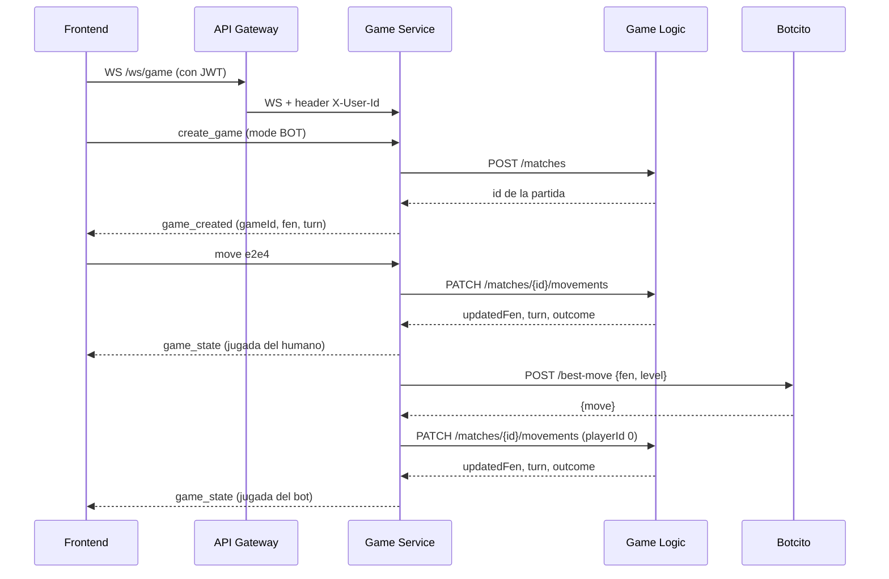

# Documentación del backend: Game Service (tarea 7) y cambios en Game Logic (tarea 6)

## Contenido
1. [Resumen](#1-resumen)
2. [Arquitectura y flujo](#2-arquitectura-y-flujo)
3. [Qué se hizo en el Game Service](#3-qué-se-hizo-en-el-game-service)
4. [Cambios hechos en Game Logic](#4-cambios-hechos-en-game-logic)
5. [Contrato para el Frontend (WebSocket)](#5-contrato-para-el-frontend-websocket)
6. [Instrucciones para el API Gateway](#6-instrucciones-para-el-api-gateway)
7. [Contrato para Botcito (Stockfish)](#7-contrato-para-botcito-stockfish)
8. [Contrato Game Service ↔ Game Logic (REST)](#8-contrato-game-service--game-logic-rest)
9. [Cómo ejecutarlo](#9-cómo-ejecutarlo)
10. [Pruebas realizadas](#10-pruebas-realizadas)
11. [Limitaciones y pendientes](#11-limitaciones-y-pendientes)

---

## 1. Resumen

El **Game Service** (tarea 7) es la pieza que conecta el frontend con la lógica de ajedrez y con el bot:

- Abre una **sesión de juego por WebSocket** (`/ws/game`).
- Soporta dos modos: **LOCAL** (dos jugadores en el mismo dispositivo) y **BOT** (humano contra Botcito, con dificultad de 1 a 20).
- Por cada jugada llama a **Game Logic** (tarea 6) para validarla y guardarla en MongoDB.
- En modo BOT, después de la jugada del humano pide la respuesta a **Botcito** (tarea 8) por REST.
- Permite **abandonar** la partida y guarda el resultado final (jaque mate, tablas o abandono).

Tecnologías: Java 21, Spring Boot 3.3.5 (Maven), WebSocket nativo de Spring. Puerto **8083**.

## 2. Arquitectura y flujo

```
Frontend ──WS──> API Gateway ──WS──> Game Service ──REST──> Game Logic ──> MongoDB
                                          │
                                          └──REST──> Botcito (Python + Stockfish)
```

Flujo de una jugada contra el bot:



Decisiones de diseño:

- **Game Logic es la única fuente de verdad de las reglas.** El Game Service no valida jugadas por su cuenta (salvo en el perfil `mock`, solo para pruebas).
- **El `gameId` que ve el cliente es el ID de MongoDB** de la partida, para usarlo luego en historial y replay.
- La sesión viva (turno, FEN actual) está **en memoria** en el Game Service; las jugadas y el resultado se guardan en MongoDB por Game Logic.
- Las llamadas a Botcito son **asíncronas** (hilos virtuales de Java 21) para no bloquear el canal WebSocket.
- Cada sesión se sincroniza (`synchronized`) para evitar que una jugada del humano y la respuesta del bot se crucen.

## 3. Qué se hizo en el Game Service

Ubicación: `Backend/GameService/`

| Archivo (paquete `com.chess.gameservice`) | Responsabilidad |
|---|---|
| `GameServiceApplication` | Arranque de Spring Boot |
| `config/WebSocketConfig` | Registra el endpoint `/ws/game` |
| `websocket/GameWebSocketHandler` | Recibe los mensajes JSON, valida el tipo, crea partidas, resuelve el ID del jugador y envía respuestas |
| `protocol/ClientMessage`, `protocol/ServerMessage` | Contrato de mensajes (ver sección 5) |
| `session/GameCoordinator` | Orquesta la partida: aplica la jugada, avisa al cliente, pide la jugada al bot, maneja abandono y fin de partida |
| `session/GameSession`, `session/SessionManager`, `session/GameMode` | Estado de cada partida en memoria (FEN, turno, modo, dificultad, IDs de jugador) |
| `modes/BotMode` | Modo contra el bot: pide la jugada a Botcito sin bloquear |
| `client/BotcitoClient` | Cliente REST de Botcito (`POST /best-move`) |
| `logic/GameLogic`, `logic/MoveResult` | Contrato con la lógica de juego |
| `logic/RestGameLogic` | Implementación por defecto: llama a Game Logic por REST |
| `logic/ChesslibGameLogic` | Implementación local para el perfil `mock` (probar sin Game Logic ni Mongo) |
| `Dockerfile`, `pom.xml`, `application.yml`, `README.md` | Build y configuración |

Convención de **ID de jugador** que se guarda en Game Logic:

| Caso | `playerId` |
|---|---|
| Usuario identificado | ID del usuario (header `X-User-Id`, o `playerId` del mensaje) |
| Sin identificar (pruebas) | `-1` |
| Botcito | `0` |
| Modo LOCAL | blancas y negras usan el mismo ID (mismo dispositivo y cuenta) |

Además se agregó `Backend/docker-compose.dev.yml` (Mongo + Game Logic + Game Service) solo para pruebas locales; el compose oficial lo mantiene Infra.

## 4. Cambios hechos en Game Logic

Ubicación: `Backend/GameLogic/`. **Avisar al responsable de la tarea 6**, porque modifican su código.

| Archivo | Cambio | Motivo |
|---|---|---|
| `Movement.java` | Se revisa `isMated()` **antes** que `isKingAttacked()` | Un jaque mate nunca se reportaba: en un mate el rey también está atacado y siempre salía "is in check" |
| `MatchController.java` | La validación compara la jugada contra `board.legalMoves()` en vez de usar `isMoveLegal(move, true)` | **Bug encontrado en pruebas:** se aceptaba `e2e5` (un peón avanzando tres casillas) y se guardaba |
| `MatchController.java` | `PATCH /matches/{id}/movements` devuelve JSON válido (`updatedFen`, `matchStatus`, `turn`, `outcome`, `reason`) | Antes devolvía un texto armado a mano que no era JSON |
| `MatchController.java` | Notación mal formada responde 400 | Antes lanzaba una excepción (500) |
| `MatchController.java` | Las rutas aceptan con y sin barra final | En Spring 6+ son rutas distintas |
| `MatchController.java` | Nuevo `PATCH /matches/{id}/result` | Guardar el resultado final (mate, tablas, abandono) |
| `MovementResponse.java` (nuevo) | Respuesta JSON del `PATCH` de jugadas, con `outcome` calculado | Resultado estructurado para el Game Service |
| `MatchResultRequest.java` (nuevo) | Cuerpo del `PATCH` de resultado | Idem |
| `MovementNotValidAdvice.java` (nuevo) | `MovementNotValidException` responde 400 | Antes respondía 500 |
| `Match.java` | Campos `createdAt`, `result`, `resultReason` y método `finish(...)` | Fecha de la partida (RNF-14) y resultado/abandono |
| `application.properties` | Puerto 8082 y URI de Mongo por variable `MONGODB_URI` | Funcionar en Docker Compose |
| `Dockerfile`, `.dockerignore` (nuevos) | Imagen del servicio | Despliegue orientado a contenedores |

## 5. Contrato para el Frontend (WebSocket)

**Endpoint:** `ws://<host>/ws/game` (directo: `ws://localhost:8083/ws/game`; en producción, a través del API Gateway).
Todos los mensajes son **JSON en texto**. Una conexión maneja **una partida activa a la vez**.

### 5.1 Mensajes que envía el cliente

| `type` | Campos | Notas |
|---|---|---|
| `create_game` | `mode` (`LOCAL` o `BOT`, obligatorio), `difficulty` (1 a 20, opcional, por defecto 10, solo BOT), `color` (`WHITE` o `BLACK`, opcional, por defecto `WHITE`, solo BOT: es el color del **humano**), `playerId` (número, opcional) | Si el API Gateway envía el header `X-User-Id`, `playerId` se ignora |
| `move` | `move` (jugada en notación UCI) | Ejemplo: `"e2e4"`. Promoción: 5.º carácter en minúscula (`"e7e8q"`, también `r`, `b`, `n`) |
| `resign` | — | Abandonar la partida |

### 5.2 Mensajes que envía el servidor

| `type` | Campos | Cuándo |
|---|---|---|
| `game_created` | `gameId`, `mode`, `fen`, `turn` | Respuesta a `create_game` |
| `game_state` | `gameId`, `fen`, `turn`, `lastMove` | Después de cada jugada válida (del humano o del bot) |
| `game_over` | `gameId`, `result`, `reason` | La partida terminó. `result`: `WHITE_WINS`, `BLACK_WINS` o `DRAW`. `reason`: `CHECKMATE`, `STALEMATE`, `DRAW_RULE` o `RESIGNATION` |
| `error` | `message` | Cualquier problema; **no cambia el estado de la partida** |

`turn` es `WHITE` o `BLACK` e indica a quién le toca **después** de la jugada. Los campos sin valor no se envían.

### 5.3 Reglas de comportamiento

1. **Esperar `game_created`** antes de enviar jugadas. Guardar el `gameId`.
2. **El `fen` es la fuente de verdad.** Redibujar el tablero a partir del `fen` de cada `game_state`.
3. **LOCAL:** las dos personas usan la misma conexión; el turno alterna según `turn`.
4. **BOT:** por cada jugada del humano llegan **dos** `game_state`: primero la jugada del humano y, unos instantes después, la del bot. Entre los dos conviene mostrar "Botcito pensando..." y bloquear el tablero hasta que `turn` vuelva a ser el color del humano. Si el humano eligió `BLACK`, el `game_state` con la apertura del bot llega justo después de `game_created`.
5. **`game_over`** llega **después** del último `game_state`. Tras eso el servidor rechaza más jugadas ("La partida ya terminó").
6. **`error`:** devolver la ficha a su casilla y mostrar el mensaje. Mensajes posibles:

| `message` | Causa |
|---|---|
| `Jugada ilegal: e2e5` | La jugada no es legal en la posición |
| `Es el turno de Botcito` | El humano movió mientras el bot piensa |
| `La partida ya terminó` | Jugada después de `game_over` |
| `No hay partida activa. Envía create_game primero.` | `move` o `resign` sin partida |
| `mode debe ser LOCAL o BOT` | `create_game` inválido |
| `JSON inválido` / `Tipo de mensaje desconocido: ...` | Mensaje mal formado |
| `El servicio de lógica de juego no respondió, intenta de nuevo` | Game Logic caído. Se puede reintentar la misma jugada |
| `No se pudo crear la partida en el servicio de lógica` | Game Logic caído al crear la partida |
| `Botcito no pudo responder: ...` | El bot falló. La partida queda esperando al bot (ver sección 11) |
| `Botcito devolvió una jugada ilegal: ...` | El bot envió una jugada que Game Logic rechazó |

7. **Abandono (`resign`):** en LOCAL abandona quien tiene el turno; en BOT abandona el humano. Responde `game_over` con `reason: RESIGNATION`.
8. **Cerrar la conexión** descarta la sesión en memoria. Las jugadas ya guardadas quedan en MongoDB, sin resultado.
9. **Resaltar movimientos válidos (RF-4):** el servidor no envía la lista de jugadas legales. El frontend puede calcularla en el cliente con una librería como `chess.js` a partir del `fen`.
10. **Historial y replay (RF-17, RF-18):** leer la partida desde Game Logic con `GET /matches/{gameId}` (a través del Gateway). Cada elemento de `movements` trae `boardFenAfterMove`, `coordinateNotation`, `playerId` y `dateTime`.
11. **Enroque:** se envía como movimiento del rey (`e1g1`). *Pendiente de probar.*

### 5.4 Ejemplo: partida contra el bot

```json
→ {"type":"create_game","mode":"BOT","difficulty":5,"color":"WHITE","playerId":1}
← {"type":"game_created","gameId":"6acbdc90622cf4c0a28609ce","mode":"BOT","fen":"rnbqkbnr/pppppppp/8/8/8/8/PPPPPPPP/RNBQKBNR w KQkq - 0 1","turn":"WHITE"}
→ {"type":"move","move":"e2e4"}
← {"type":"game_state","gameId":"6acbdc90622cf4c0a28609ce","fen":"rnbqkbnr/pppppppp/8/8/4P3/8/PPPP1PPP/RNBQKBNR b KQkq e3 0 1","turn":"BLACK","lastMove":"e2e4"}
← {"type":"game_state","gameId":"6acbdc90622cf4c0a28609ce","fen":"...","turn":"WHITE","lastMove":"e7e5"}
```

### 5.5 Ejemplo: final por jaque mate (modo LOCAL)

```json
← {"type":"game_state","gameId":"6acbc5a9fb75ceb2ebdbf825","fen":"rnb1kbnr/pppp1ppp/8/4p3/6Pq/5P2/PPPPP2P/RNBQKBNR w KQkq - 1 3","turn":"WHITE","lastMove":"d8h4"}
← {"type":"game_over","gameId":"6acbc5a9fb75ceb2ebdbf825","result":"BLACK_WINS","reason":"CHECKMATE"}
```

## 6. Instrucciones para el API Gateway

1. **Ruta WebSocket:** `/ws/game` → `ws://game-service:8083/ws/game`. El proxy debe reenviar los headers `Upgrade` y `Connection` y mantener la conexión abierta sin límite de inactividad corto (una partida puede tener pausas largas; se recomienda al menos 10 minutos).
2. **JWT:** verificar el token **antes** de aceptar el upgrade.
3. **Header `X-User-Id`:** después de verificar el JWT, enviar al Game Service el header `X-User-Id` con el ID numérico del usuario (el Game Service lo interpreta como número entero largo). **Borrar** cualquier `X-User-Id` que venga del cliente, para que no se pueda suplantar a otro jugador.
4. **Rutas REST de historial y replay** (hacia Game Logic, `http://game-logic:8082`): `GET /matches/{id}` y `GET /players/{id}/matches`. Las respuestas siguen el formato HAL de Spring HATEOAS (incluyen `_links`).
5. **CORS:** el Game Service acepta cualquier origen en el WebSocket porque se asume que el Gateway ya aplica CORS.
6. **Exposición de puertos:** en el compose oficial, no publicar 8082 ni 8083 hacia afuera; solo el Gateway debe ser accesible.
7. **Health check del Game Service:** `GET /actuator/health` → `{"status":"UP"}`.

## 7. Contrato para Botcito (Stockfish)

El Game Service llama a Botcito cuando es el turno del bot.

**Petición**

```
POST {BOTCITO_URL}/best-move
Content-Type: application/json

{"fen": "rnbqkbnr/pppppppp/8/8/4P3/8/PPPP1PPP/RNBQKBNR b KQkq e3 0 1", "level": 5}
```

**Respuesta esperada (HTTP 200)**

```
Content-Type: application/json

{"move": "e7e5"}
```

Requisitos:

- **`move` en notación UCI:** casilla de origen más destino en minúsculas (`e7e5`), con letra de promoción (`e7e8q`) cuando corresponda. No usar notación SAN (`Nf3`) ni la salida cruda de Stockfish (`bestmove e7e5 ponder ...`).
- **`level` va de 1 a 20.** Botcito lo traduce a fuerza de juego (por ejemplo `Skill Level` de Stockfish, o un Elo limitado).
- **Sin estado:** el FEN trae la posición completa; Botcito no necesita recordar partidas.
- **Jugada legal para ese FEN.** Si no lo es, Game Logic la rechaza y el cliente recibe un `error`.
- **Errores:** responder un código HTTP de error (por ejemplo 400 si el FEN es inválido, 409 si no hay jugadas legales). El Game Service lo transforma en `error` para el cliente.
- **Tiempos:** el Game Service espera 3 s para conectar y 15 s para recibir la respuesta. Si Botcito tarda más, la jugada falla.
- **Cuerpo de la petición:** puede llegar con `Content-Length` o con `Transfer-Encoding: chunked`. Los frameworks habituales (FastAPI, Flask con gunicorn) leen ambos sin cambios. Un servidor hecho a mano con `http.server` debe leer los dos casos (el `fake_botcito.py` ya lo hace).

Prueba rápida desde PowerShell:

```powershell
Invoke-RestMethod -Method Post -Uri http://localhost:8000/best-move -ContentType 'application/json' -Body '{"fen":"rnbqkbnr/pppppppp/8/8/4P3/8/PPPP1PPP/RNBQKBNR b KQkq e3 0 1","level":5}'
```

Para probar el modo BOT antes de que exista el Botcito real hay un servidor falso (`fake_botcito.py`, requiere `pip install chess`) que responde una jugada legal al azar con este mismo contrato.

## 8. Contrato Game Service ↔ Game Logic (REST)

Game Logic escucha en el puerto **8082**. El Game Service usa estos endpoints:

| Momento | Petición | Respuesta |
|---|---|---|
| Crear partida | `POST /matches` con `{"whitePlayerId":1,"blackPlayerId":2}` | 201 con la partida (`id`, `createdAt`, `movements`, `result`, `resultReason`, `_links`) |
| Cada jugada | `PATCH /matches/{id}/movements` con `{"boardFenBeforeMove":"<fen>","coordinateNotation":"e2e4","playerId":1}` | 200 con `{"updatedFen","matchStatus","turn","outcome","reason"}` |
| Jugada ilegal | Mismo `PATCH` | 400 con el motivo en texto |
| Partida inexistente | Cualquiera con un ID que no existe | 404 |
| Fin de partida | `PATCH /matches/{id}/result` con `{"result":"BLACK_WINS","reason":"CHECKMATE"}` | 200 con la partida |
| Consultas | `GET /matches/{id}`, `GET /players/{id}/matches` | Partida(s) en formato HAL |

Valores de la respuesta de jugada:

- `turn`: `WHITE` o `BLACK` (a quién le toca después).
- `outcome`: `IN_PROGRESS`, `WHITE_WINS`, `BLACK_WINS` o `DRAW`.
- `reason`: `CHECKMATE`, `STALEMATE` o `DRAW_RULE` cuando la partida terminó; vacío en otro caso.
- `matchStatus`: texto descriptivo (`Normal`, `White is in check`, `White is in checkmate`, etc.).

Ejemplo real de respuesta a `e2e4` desde la posición inicial:

```json
{"updatedFen":"rnbqkbnr/pppppppp/8/8/4P3/8/PPPP1PPP/RNBQKBNR b KQkq e3 0 1","matchStatus":"Normal","turn":"BLACK","outcome":"IN_PROGRESS","reason":null}
```

## 9. Cómo ejecutarlo

Variables de entorno del Game Service:

| Variable | Valor por defecto | Uso |
|---|---|---|
| `GAMELOGIC_URL` | `http://localhost:8082` | URL de Game Logic |
| `BOTCITO_URL` | `http://botcito:8000` | URL de Botcito |
| `SPRING_PROFILES_ACTIVE` | (ninguno) | Con `mock` usa `chesslib` local y no necesita Game Logic ni Mongo |

Variable de Game Logic: `MONGODB_URI` (por defecto `mongodb://localhost:27017/chess`).

Todo junto (requiere Docker Desktop), desde `Backend/`:

```powershell
docker compose -f docker-compose.dev.yml up --build
```

Para probar el modo BOT con el Botcito falso desde Docker en Windows, la línea `BOTCITO_URL` del compose debe ser `http://host.docker.internal:8000` y el script debe estar corriendo en la PC (`python fake_botcito.py`).

Cliente de prueba desde la consola del navegador (F12 en una pestaña con origen `http://localhost`):

```js
const ws = new WebSocket('ws://localhost:8083/ws/game');
ws.onmessage = e => console.log(e.data);
const send = o => ws.send(JSON.stringify(o));
send({type:'create_game', mode:'LOCAL', playerId:1})
send({type:'move', move:'f2f3'})
```

## 10. Pruebas realizadas

Todas manuales. **No hay pruebas automáticas todavía.** Estado: ✅ pasó · ⚠️ falló y se corrigió · ⬜ pendiente de confirmar o ejecutar.

| # | Prueba | Cómo | Resultado | Estado |
|---|---|---|---|---|
| 1 | Arranque de los tres contenedores | `docker compose -f docker-compose.dev.yml up --build` | Game Logic (Boot 4.1.1) conectó a Mongo; Game Service arrancó en 8083 | ✅ |
| 2 | Health del Game Service | `GET /actuator/health` | `{"status":"UP"}` | ✅ |
| 3 | Partida inexistente | `GET /matches/prueba` | "Could not find match prueba" | ✅ |
| 4 | Crear partida en Game Logic | `POST /matches` | Devolvió ID `6acbc1b0fb75ceb2ebdbf823` | ✅ |
| 5 | Jugada legal por REST | `PATCH /matches/{id}/movements` con `e2e4` | JSON con `updatedFen`, `turn: BLACK`, `outcome: IN_PROGRESS` | ✅ |
| 6 | Consulta de la partida | `GET /matches/{id}` | Muestra `createdAt`, la jugada guardada con `playerId`, `result: null` y `resultReason: null` mientras la partida sigue | ✅ |
| 7 | Handshake WebSocket | `curl.exe` con headers de upgrade | `HTTP/1.1 101` con `Upgrade: websocket` | ✅ |
| 8 | Modo LOCAL: mate del tonto | Consola del navegador: `create_game` (LOCAL) y las jugadas `f2f3`, `e7e5`, `g2g4`, `d8h4` | Cuatro `game_state` y `game_over` con `BLACK_WINS` y `CHECKMATE` | ✅ |
| 9 | Abandono | `resign` en una partida LOCAL | `game_over` con `RESIGNATION` | ✅ |
| 10 | Jugada después del fin | `move` tras `game_over` | `error` "La partida ya terminó" | ✅ |
| 11 | Jugada ilegal (`e2e5`) | `move` con `e2e5` desde la posición inicial | **El peón se movió a e5 y se guardó.** Bug en Game Logic (`isMoveLegal`) | ⚠️ Corregido en `MatchController` (ver sección 4) |
| 12 | Re-prueba de jugadas ilegales tras la corrección | `e2e5`, `e7e5` en turno de blancas, `a1a3`, `b1b3`, `e1e2`, `e4e5` (origen vacío) | Esperado: `error` "Jugada ilegal" en todas | ⬜ |
| 13 | Jugada legal tras la corrección | `g1f3` | Esperado: `game_state` normal | ⬜ |
| 14 | Mate del tonto guardado en Mongo | `GET /matches/{gameId}` de la partida de la prueba 8 | Esperado: 4 jugadas, `result: BLACK_WINS`, `resultReason: CHECKMATE`, último `boardStatusAfterMove: "White is in checkmate"` | ⬜ |
| 15 | Resultado del abandono guardado | `GET /matches/{gameId}` de la prueba 9 | Esperado: `resultReason: RESIGNATION` | ⬜ |
| 16 | Modo BOT, primer intento | `create_game` BOT y `move e2e4` con el Botcito falso | **Falló:** `Botcito no pudo responder`. El script falso no leía cuerpos con `Transfer-Encoding: chunked` | ⚠️ Corregido en `fake_botcito.py` |
| 17 | Modo BOT tras la corrección del script | Igual que la 16 | Esperado: dos `game_state` por jugada (humano y bot) | ⬜ |
| 18 | Modo BOT jugando con negras | `create_game` con `color: BLACK` | Esperado: la apertura del bot llega sin mover | ⬜ |
| 19 | Jugadas del bot en Mongo | `GET /matches/{gameId}` de una partida BOT | Esperado: jugadas del humano con `playerId` 1 y del bot con `playerId` 0 | ⬜ |
| 20 | Bot apagado | Cerrar el script y mover | Esperado: `error` "Botcito no pudo responder..." | ⬜ |
| 21 | Abandono contra el bot | `resign` en modo BOT | Esperado: gana el color del bot | ⬜ |
| 22 | Jaque mate por REST | `PATCH` con el FEN del mate y `d8h4` | Esperado: `outcome: BLACK_WINS`, `matchStatus: White is in checkmate` | ⬜ |
| 23 | Integración con API Gateway y frontend | — | Depende de las tareas 2, 3 y 4 | ⬜ |

## 11. Limitaciones y pendientes

- **Sin reintento si Botcito falla.** La partida queda esperando al bot y el humano no puede mover; la salida es `resign`. Se puede agregar un mensaje `retry_bot`.
- **Tablas por repetición de posición no se detectan.** Cada jugada se valida desde un FEN, sin historial. Funcionan jaque mate, ahogado, material insuficiente y regla de los 50 movimientos.
- **Multijugador en línea (RF-15), desconexión y reconexión (RF-23), emparejamiento y Elo (RF-10, RF-11, RF-21):** fuera del alcance de esta entrega.
- **Sesión en memoria:** si el Game Service se reinicia se pierden las partidas en curso (las jugadas ya guardadas siguen en MongoDB, pero no se puede reanudar la sesión).
- **Partidas cerradas por desconexión** (cierre del navegador) quedan sin resultado en MongoDB.
- **Seguridad:** el Game Service confía en `X-User-Id`; es seguro solo si el Gateway lo fija y los puertos 8082 y 8083 no están expuestos. Game Logic acepta cualquier FEN que reciba por REST.
- **Lista de jugadas legales:** el servidor no la envía (ver regla 9 de la sección 5.3).
- **Dos herramientas de build:** el Game Service usa Maven y Game Logic usa Gradle. Funciona, pero convendría unificar.
- **El tutor con LLM** no interviene en este servicio; entra después, para explicar jugadas.