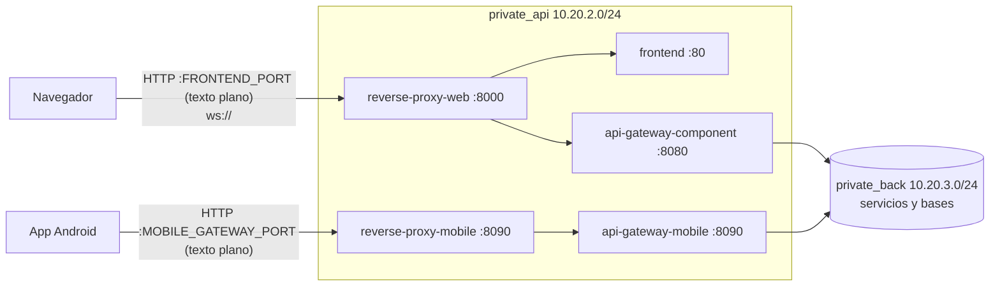
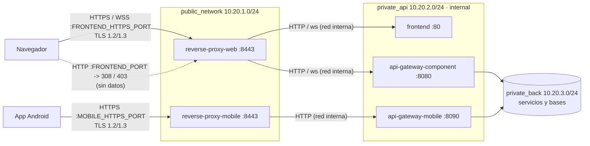

# Prototype 3 · Escenario de seguridad 1: Secure Channel (TLS)

Rama: `feature/secure-channel-waf` = `origin/feature/waf-security` (`368f93a`, WAF de Kevin sobre los dos
reverse proxies y el subnetting de Daniel) + merge de `feature/secure-channel-tls` (5 commits del canal seguro)
+ integración con el WAF. Hay **dos modos de despliegue**, con pruebas separadas:

| Modo | Compose | Entrada pública | TLS |
|---|---|---|---|
| **Directo** (secciones 1–10) | `compose.yaml` | `reverse-proxy-web` / `reverse-proxy-mobile` | cliente ⇒ proxy |
| **Integrado con WAF** (sección 11) | `compose.yaml` + `Backend/waf/compose.waf.yaml` + `Backend/waf/compose.waf-tls.yaml` (+ `compose.waf-methods.yaml`, propuesta) | `waf-web` / `waf-mobile` | cliente ⇒ WAF ⇒ proxy (dos canales TLS validados) |


## 1. Escenario de seguridad

| Elemento | Valor |
|---|---|
| **Fuente** | Atacante en la misma red que el cliente (Wi-Fi pública o compartida, red del campus) o en el camino de red: puede escuchar (pasivo) o interponerse (activo, *man-in-the-middle*). |
| **Estímulo** | Intercepta o modifica el tráfico entre el cliente (navegador o app Android) y el sistema para robar credenciales, la cookie `session` o el JWT, leer o alterar partidas, o suplantar al servidor. |
| **Entorno** | Operación normal; el cliente accede por una red pública no confiable. |
| **Artefacto** | Canal cliente → sistema: entradas `reverse-proxy-web` (páginas, REST `/api/*`, WebSocket `/api/ws/*`) y `reverse-proxy-mobile` (REST de la app). |
| **Respuesta** | Todo dato de la aplicación viaja cifrado y con integridad (TLS 1.2/1.3). El cliente autentica al servidor con su certificado. El HTTP en claro no transporta datos: las páginas redirigen a HTTPS y la API responde 403. La cookie de sesión solo se envía por HTTPS (`Secure`). |
| **Medida de la respuesta** | 100 % de las peticiones con datos sobre TLS ≥ 1.2. 0 conexiones aceptadas con TLS 1.0/1.1. 0 conexiones completadas con certificado no confiable o nombre incorrecto. 0 respuestas de la API por HTTP. La cookie `session` siempre con `Secure; HttpOnly; SameSite=Lax`. Lo mide `verificar_canal_seguro.py` (sección 9). |

## 2. Problema que se resuelve

Hasta el Prototype 2 las dos entradas escuchaban solo HTTP (`:8000` web y `:8090` móvil). En una red no
confiable un atacante podía:

- leer usuario y contraseña en `POST /api/auth/login` y `/auth/register`;
- copiar la cookie `session` (web) o el `accessToken` (app) y suplantar al usuario hasta que vence (1 h);
- leer y modificar las jugadas del WebSocket `ws://` en vivo;
- hacerse pasar por el servidor: sin certificado, el cliente no puede distinguir el sistema real de uno falso.

El reverse proxy (escenario 2) y la segmentación de red (escenario 3) protegen lo que hay **detrás** de la
entrada, pero no el tramo **cliente → entrada**, que cruza redes que no controlamos.

## 3. Secure Channel Pattern y por qué

*Secure Channel* establece un canal que garantiza **confidencialidad**, **integridad** y **autenticación del
servidor** entre dos extremos sobre una red insegura. Se implementa con TLS:

- **Estándar y soportado por todos los clientes**: navegadores (HTTPS/WSS), OkHttp en Android y las
  bibliotecas de pruebas. No hace falta código criptográfico propio.
- **Punto natural de terminación**: los reverse proxies ya son la única puerta pública. Terminar TLS ahí
  protege a la vez la web, la API, el WebSocket y la app, sin tocar microservicios ni crear uno nuevo.
- **Separación de responsabilidades**: Nginx hace el TLS. El gateway solo marca la cookie como `Secure`
  (`COOKIE_SECURE=true`) y acepta el origen `https://` (`WS_ALLOWED_ORIGINS`), que ya eran configurables.
- **Alternativas descartadas**: TLS en cada microservicio (mTLS) cifraría también la red interna, pero exige
  certificados por servicio y cambios en todos ellos (sección 7). Cifrar en la aplicación sería código propio,
  frágil y sin autenticación del servidor estándar.

## 4. Tácticas arquitectónicas aplicadas (resistir ataques)

| Táctica | Cómo se aplica |
|---|---|
| **Cifrar datos** | TLS 1.2/1.3 con suites ECDHE + AEAD (AES-GCM, ChaCha20-Poly1305); secreto perfecto hacia adelante. |
| **Autenticar actores** (al servidor) | Certificado X.509 firmado por una CA en la que confía el cliente; se verifican cadena y nombre (SAN). |
| **Mantener la integridad** | AEAD de TLS: cualquier modificación en tránsito rompe la conexión. |
| **Limitar la exposición** | HTTP sin datos: `/api/*` → 403 y páginas → 308. El HTTP del proxy móvil ya no se publica. TLS 1.0/1.1 deshabilitados y sin *session tickets*. |
| **Limitar el acceso** (a la sesión) | Cookie `Secure; HttpOnly; SameSite=Lax`. HSTS (configurable) para que el navegador no vuelva a intentar HTTP. |

## 5. Arquitectura anterior y resultante

**Antes** (escenarios 2 y 3, sin cifrado en el borde):



**Después** (este escenario):



Se conservan las redes, las IP fijas (`10.20.1.11/12`, `10.20.2.10/11`), el enrutamiento por ruta y la
separación web/móvil. Solo los dos proxies publican puertos.

| Entrada | Antes | Después |
|---|---|---|
| Web | `http://host:FRONTEND_PORT` (`:8000`) | `https://host:FRONTEND_HTTPS_PORT` (`:8443`); `FRONTEND_PORT` queda solo para redirigir |
| WebSocket | `ws://…/api/ws/*` | `wss://…/api/ws/*` (el frontend elige `wss` solo cuando la página es `https:`) |
| Android | `http://host:MOBILE_GATEWAY_PORT` (`:8090`) | `https://host:MOBILE_HTTPS_PORT` (`:8443`); el `:8090` ya no se publica |

## 6. Componentes y archivos modificados

| Archivo | Cambio |
|---|---|
| `Backend/reverse-proxy/nginx/common.conf` | Política TLS común: `ssl_protocols TLSv1.2 TLSv1.3`, cifrados ECDHE+AEAD, sin *session tickets*, caché de sesión. |
| `Backend/reverse-proxy/nginx/web.conf.template` (antes `web.conf`) | Server TLS `:8443` con las mismas rutas y cabeceras (WebSocket `Upgrade`/`Connection`, bloqueo de `/api/internal`, `X-User-Id` vaciado, rate limit) más HSTS. Server HTTP `:8000`: `/health`, páginas → 308 y `/api/*` → 403 `HTTPS_REQUIRED`. |
| `Backend/reverse-proxy/nginx/mobile.conf.template` (antes `mobile.conf`) | Server TLS `:8443` con las mismas rutas. HTTP `:8090` solo `/health`, sin publicar. |
| `Backend/reverse-proxy/Dockerfile` | Plantillas en `/etc/nginx/templates` (las procesa `envsubst` de la imagen, filtrado a `PUBLIC_HTTPS_PORT` y `HSTS_MAX_AGE`); `EXPOSE 8443`. Los certificados no van en la imagen. |
| `compose.yaml` | Publica `FRONTEND_HTTPS_PORT:8443` y `MOBILE_HTTPS_PORT:8443`; monta `WEB_TLS_DIR` y `MOBILE_TLS_DIR` en `/etc/nginx/certs` en solo lectura y sin crear la ruta. |
| `.env.example` | Nuevas variables de TLS; `COOKIE_SECURE` y `WS_ALLOWED_ORIGINS` documentadas para HTTPS. |
| `.gitignore` | `certs/`, `*.key`, `*.pem`, `*.crt`, `*.p12` y `*.pfx` nunca se suben. |
| `mobile/app/build.gradle.kts` | `BASE_URL` HTTPS en debug (`https://10.0.2.2:8444/`) y en release; ambos configurables con propiedades de Gradle; el build falla si la URL no es `https://`. |
| `mobile/app/src/debug/res/xml/network_security_config.xml` | Debug: sin HTTP en claro; confía en las CA del sistema y en las instaladas por el usuario (la CA de desarrollo). |
| `mobile/app/src/main/res/xml/network_security_config.xml` | Release: sin HTTP en claro; solo CA del sistema (explícito). |
| `Backend/reverse-proxy/secure-channel/validar_config.py` | Validación estática (sin Docker). |
| `Backend/reverse-proxy/secure-channel/verificar_canal_seguro.py` | Verificación contra el stack en Docker; genera la evidencia en JSON. |
| `Backend/reverse-proxy/escenarios/medir_resistencia.py` | (Compatibilidad con el escenario 2) mide por HTTPS validando el certificado; `PROXY_SCHEME=http` conserva el modo anterior. |

**Sin cambios:** la lógica de Auth, Game Logic, Multiplayer, Single Player, Tutor, Botcito y los gateways
(el gateway ya leía `COOKIE_SECURE` y `WS_ALLOWED_ORIGINS`); el frontend (ya usa `wss` cuando la página es
`https:`); las redes Docker y el WAF (sigue comentado).

## 7. Alcance real del cifrado y limitaciones

- **Protege:** cliente ↔ reverse proxy (web, REST, WebSocket y app). Es el tramo que cruza redes no confiables.
- **No protege (no es cifrado extremo a extremo):** reverse proxy → frontend/gateways → microservicios →
  bases de datos y RabbitMQ siguen con sus protocolos actuales (HTTP, `ws://`, AMQP, Mongo, MySQL,
  PostgreSQL) **sin cifrar**, dentro de las redes Docker internas (`private_api` y `private_back` son
  `internal: true`). Su protección es la segmentación del escenario 3, no el cifrado. Si un contenedor
  interno se compromete, puede leer ese tráfico. Cifrarlo requeriría mTLS entre servicios (o una *service
  mesh*), con certificados por servicio y cambios en cada cliente HTTP, AMQP y de base de datos.
- **El proxy ve el tráfico en claro**: termina TLS. Es una pieza de confianza; su clave privada es el secreto
  más sensible del despliegue.
- **Certificados de desarrollo**: la CA de mkcert solo es confiable en las máquinas donde se instaló. En
  producción se necesita un dominio y una CA pública (sección 8).
- **HSTS en `localhost`** queda en `0`: un HSTS largo en `localhost` afectaría a cualquier otro servidor
  local del desarrollador. En producción: `HSTS_MAX_AGE=31536000`.
- **El HTTP `:FRONTEND_PORT` sigue publicado**, pero solo para redirigir páginas. Un primer acceso tecleando
  `http://` puede ser interceptado antes de la redirección; HSTS en producción lo evita en los siguientes.
- **No hay *certificate pinning* en Android**: se confía en la CA (del sistema en release). Es lo
  recomendado salvo requisitos especiales; el *pinning* complica la rotación de certificados.

## 8. Procedimiento de despliegue (Windows, Docker Desktop, PowerShell)

### 8.1 Certificado de desarrollo confiable (mkcert)

```powershell
winget install FiloSottile.mkcert          # o: choco install mkcert
mkcert -install                            # crea la CA local y la añade a la confianza de Windows y Chrome/Edge
New-Item -ItemType Directory -Force certs | Out-Null
mkcert -cert-file certs\tls.crt -key-file certs\tls.key `
  localhost 127.0.0.1 ::1 10.0.2.2 reverse-proxy-web reverse-proxy-mobile
mkcert -CAROOT                             # carpeta de rootCA.pem (para pruebas y Android)
```

- `10.0.2.2` es el PC visto desde el emulador de Android. `reverse-proxy-web` y `reverse-proxy-mobile` los
  usa la medición del escenario 2 desde dentro de la red Docker.
- `certs/` está en `.gitignore`. **Nunca compartas `rootCA-key.pem`** (la clave de la CA de mkcert).
- Firefox usa su propio almacén: `mkcert -install` lo cubre si tiene NSS; si no, importa `rootCA.pem` en
  Firefox (Ajustes → Privacidad → Certificados).
- En Linux/macOS, la imagen corre como uid 101: la clave debe poder leerla ese usuario
  (`chmod 644 certs/tls.key` en desarrollo o `sudo chown 101 certs/tls.key`). En Docker Desktop para Windows
  no hace falta.

### 8.2 Variables de entorno

**No sobrescribas tu `.env`**. Este bloque solo añade las variables que falten:

```powershell
$nuevas = [ordered]@{ FRONTEND_PORT='8080'; FRONTEND_HTTPS_PORT='8443'; MOBILE_HTTPS_PORT='8444'
                      WEB_TLS_DIR='./certs'; MOBILE_TLS_DIR='./certs'; HSTS_MAX_AGE='0' }
$actual = if (Test-Path .env) { Get-Content .env } else { @() }
foreach ($k in $nuevas.Keys) { if (-not ($actual -match "^$k=")) { Add-Content .env "$k=$($nuevas[$k])"; "añadida $k" } }
```

Después edita a mano en `.env` estas dos (no se imprimen secretos):

```
COOKIE_SECURE=true
WS_ALLOWED_ORIGINS=https://localhost:8443
```

`MOBILE_GATEWAY_PORT` ya no se usa (el HTTP del proxy móvil no se publica). Para usar los puertos estándar:
`FRONTEND_PORT=80`, `FRONTEND_HTTPS_PORT=443` y `WS_ALLOWED_ORIGINS=https://localhost`.

### 8.3 Arrancar y comprobar

```powershell
docker compose config --quiet; "config: $LASTEXITCODE"      # 0 = válido
docker compose up --build -d
docker compose ps -a                                         # reverse-proxy-web y -mobile: healthy
docker compose logs --tail=50 reverse-proxy-web reverse-proxy-mobile
docker compose exec reverse-proxy-web nginx -t               # sintaxis + certificados cargados
docker compose exec reverse-proxy-mobile nginx -t
```

Abre `https://localhost:8443`: candado sin advertencias. `http://localhost:8080` debe redirigir.

### 8.4 Despliegue real (dominio y CA pública)

1. Dominio (p. ej. `juego.tu-dominio.com` y `api.tu-dominio.com`) apuntando al servidor.
2. Certificado de una CA pública, p. ej. Let's Encrypt con `certbot certonly --standalone -d …`.
   Copia `fullchain.pem` → `tls.crt` y `privkey.pem` → `tls.key` en directorios propios por entrada y
   apunta `WEB_TLS_DIR` y `MOBILE_TLS_DIR` a ellos (permisos 600 y dueño 101, fuera del repositorio).
3. `.env`: `FRONTEND_PORT=80`, `FRONTEND_HTTPS_PORT=443`, `HSTS_MAX_AGE=31536000`, `COOKIE_SECURE=true` y
   `WS_ALLOWED_ORIGINS=https://juego.tu-dominio.com`.
4. Renovación: reemplaza los archivos y ejecuta `docker compose restart reverse-proxy-web reverse-proxy-mobile`.
5. Android release: `.\gradlew assembleRelease -PinsightfulReleaseBaseUrl=https://api.tu-dominio.com/`. El
   build falla si la URL no es `https://`.

### 8.5 Android en el emulador (debug)

```powershell
adb push "$(mkcert -CAROOT)\rootCA.pem" /sdcard/Download/insightful-dev-ca.pem
```

En el emulador: Ajustes → Seguridad (o Seguridad y privacidad) → Cifrado y credenciales → Instalar un
certificado → **Certificado de CA** → `insightful-dev-ca.pem`. Compila e instala la variante debug
(`BASE_URL=https://10.0.2.2:8444/`). Para un dispositivo físico:
`.\gradlew installDebug -PinsightfulDebugBaseUrl=https://<IP-del-PC>:8444/`, generando el certificado con esa IP.

La variante **debug** confía en las CA instaladas por el usuario; la **release** solo en las del sistema.
Ninguna acepta certificados arbitrarios: no hay `TrustManager` permisivo ni se desactiva la verificación
de nombre.

## 9. Pruebas

Las del modo integrado con WAF están en 11.7; los resultados de ambos modos se escriben por separado
(`resultados-canal-seguro-directo.json` y `resultados-canal-seguro-waf.json`).

### 9.1 Ejecutadas en este entorno (sin Docker, sin Nginx, sin emulador)

Del modo integrado, sin Docker: `validar_config.py` [waf] **47/47** (fusión de las tres capas de Compose);
6 controles negativos detectados (verificación desactivada, `BACKEND` HTTP, variable mal escrita, solo la
capa de Kevin → 23/45, métodos de más, CA del sistema); certificados internos verificados con OpenSSL
(`-x509_strict`, `-purpose sslserver`, `-verify_depth 1`, `-verify_hostname`): válidos para su nombre,
*Hostname mismatch* con el nombre equivocado y *unable to get local issuer* con la otra CA.

| Prueba | Contra qué | Resultado |
|---|---|---|
| `validar_config.py`: plantillas renderizadas como en la imagen y analizadas con crossplane (estricto) más 38 reglas de la política TLS, HTTP y Compose | Archivos de la rama | **40/40** |
| Control negativo del validador (directiva mal escrita y `TLSv1` reintroducido) | Copia temporal | Detectado (4 fallos esperados) |
| Gateway web **real** con `COOKIE_SECURE=true` y `WS_ALLOWED_ORIGINS=https://localhost:8443`: cookie `Secure; HttpOnly; SameSite=Lax` en login y logout; WebSocket aceptado con origen `https://`; `http://` y origen ajeno → 4403 | Gateway real; Auth, Game Logic y Single Player simulados | **7/7** |
| Lógica TLS de `verificar_canal_seguro.py`: TLS 1.2/1.3 aceptados; 1.0/1.1 rechazados; certificado no confiable y nombre incorrecto rechazados | Servidores TLS de prueba en Python (**simulados**, no Nginx), uno correcto y otro que acepta TLS 1.0 | Correcto: 7/7 en el bueno; en el malo fallan exactamente TLS 1.0 y 1.1 |
| Cliente interno del escenario 2 valida el certificado | Servidor HTTPS de prueba con certificado de la CA y con uno autofirmado | Acepta el primero y rechaza el segundo |
| Compilación Android `assembleDebug` y `assembleRelease` | Gradle con el SDK local y el JDK de Android Studio | BUILD SUCCESSFUL; `BuildConfig.BASE_URL`: debug `https://10.0.2.2:8444/`, release `https://…/` |
| Gradle rechaza un `BASE_URL` `http://` (`-PinsightfulDebugBaseUrl=http://…`) | Gradle | BUILD FAILED con «debe empezar por https://» |

### 9.2 Pendientes (requieren Docker Desktop o un emulador)

Ejecútalas tras la sección 8:

```powershell
pip install websockets
$env:TLS_CA_FILE = "$(mkcert -CAROOT)\rootCA.pem"
$env:FRONTEND_PORT = '8080'; $env:FRONTEND_HTTPS_PORT = '8443'; $env:MOBILE_HTTPS_PORT = '8444'
python Backend\reverse-proxy\secure-channel\verificar_canal_seguro.py
```

Cubre: HTTPS con certificado confiable; TLS 1.2 y 1.3 aceptados; TLS 1.0 y 1.1 rechazados por el servidor;
certificado no confiable y nombre incorrecto rechazados; HSTS; HTTP `/health` 200, páginas 308 y `/api/*`
403; registro y login por HTTPS; cookie `Secure`; petición autenticada; partida por **WSS**; WSS desde
`http://` → 4403; `/api/internal/*` y `/internal/*` → 404; login de la app por HTTPS; puertos internos y el
`8090` no publicados. Escribe `resultados-canal-seguro.json`.

Comprobaciones manuales complementarias:

```powershell
# Protocolos (OpenSSL de Git for Windows)
openssl s_client -connect localhost:8443 -tls1_1 -CAfile "$(mkcert -CAROOT)\rootCA.pem" </dev/null   # debe fallar
openssl s_client -connect localhost:8443 -tls1_3 -CAfile "$(mkcert -CAROOT)\rootCA.pem" </dev/null   # Verify return code: 0 (ok)
# Redirección y API por HTTP
curl.exe -sI http://localhost:8080/estadisticas            # 308, Location: https://localhost:8443/estadisticas
curl.exe -s  http://localhost:8080/api/stats/me            # 403 HTTPS_REQUIRED
# Escenario 2 sobre HTTPS
python Backend\reverse-proxy\escenarios\medir_resistencia.py
```

- **Navegador:** inicia sesión en `https://localhost:8443`, abre DevTools → Application → Cookies (`session`
  con *Secure* marcado) → Network → WS (`wss://localhost:8443/api/ws/games/…`) y juega una partida local, una
  contra Botcito y una multijugador.
- **Android:** con la CA instalada, inicia sesión en la app. Quita la CA (Ajustes → Credenciales de usuario)
  y repite: debe fallar con error de certificado (prueba de que no se acepta cualquier certificado).

## 10. Evidencia para el informe y la exposición

1. `Backend/reverse-proxy/secure-channel/resultados-canal-seguro.json` (fecha, versión de OpenSSL, cada
   prueba con su resultado) y la salida de consola de `verificar_canal_seguro.py`.
2. Salida de `validar_config.py` (40/40) y de `docker compose exec reverse-proxy-web nginx -t`.
3. Capturas: candado y certificado en el navegador; DevTools → Security (TLS 1.3, cifrado); cookie `session`
   con *Secure*; frames WebSocket en `wss://`.
4. `openssl s_client` con `-tls1_1` rechazado y con `-tls1_3` aceptado.
5. `curl.exe -sI http://…` mostrando el 308 y el 403 `HTTPS_REQUIRED`.
6. Comparación del escenario 2 (`medir_resistencia.py`) por HTTPS: las protecciones del proxy se mantienen.
7. Android: login correcto con la CA instalada y fallo al quitarla.
8. Opcional (muy ilustrativo): captura de Wireshark del puerto 8443 (solo `TLSv1.3 Application Data`)
   frente a la del Prototype 2 en HTTP (credenciales visibles).

## 11. Modo integrado: WAF + Secure Channel

### 11.1 Arquitectura y dónde termina cada canal

```
Navegador ══TLS① (cert. público mkcert)══► waf-web:8443  [ModSecurity + OWASP CRS inspecciona]
          ══TLS② (CA interna, nombre reverse-proxy-web verificado)══► reverse-proxy-web:8443
          ──HTTP / ws (private_api, fuera del alcance)──► frontend:80 / api-gateway-component:8080

Android   ══TLS① (cert. público mkcert)══► waf-mobile:8443 [ModSecurity + OWASP CRS]
          ══TLS② (CA interna, nombre reverse-proxy-mobile verificado)══► reverse-proxy-mobile:8443
          ──HTTP (private_api, fuera del alcance)──► api-gateway-mobile:8090
```

- **TLS①** termina en el WAF: es necesario para que ModSecurity vea la petición HTTP (no se puede inspeccionar
  tráfico cifrado). **TLS②** es una conexión nueva del WAF al proxy, en `waf-edge`.
- Los proxies **no cambian**: misma imagen, mismas plantillas, mismas rutas, bloqueo de `/internal`,
  `X-User-Id` vaciado, rate limit y cabeceras WebSocket. Solo cambia el certificado montado (el interno).
- Publican puertos **solo los WAF** (`compose.waf.yaml` ya quita los de los proxies con `ports: !override []`):
  `waf-web` → `FRONTEND_PORT:8080` (HTTP, solo 301) y `FRONTEND_HTTPS_PORT:8443`; `waf-mobile` →
  `MOBILE_HTTPS_PORT:8443`. El HTTP móvil no se publica. Así el navegador sigue en `https://localhost:8443`
  (`WS_ALLOWED_ORIGINS` no cambia) y Android en `https://10.0.2.2:8444/` (sin cambios en la app).

### 11.2 Cómo se configura (verificado contra el código de la imagen)

`Backend/waf/compose.waf-tls.yaml` es una tercera capa; no modifica `compose.yaml` ni `compose.waf.yaml`.
Las variables se comprobaron en `coreruleset/modsecurity-crs-docker` (`nginx/Dockerfile`,
`templates/includes/proxy_backend_ssl.conf.template`, `docker-entrypoint.d/93-update-proxy-ssl-config.sh`,
`src/bin/check-proxy-client-cert`):

| Variable | Valor | Efecto en el Nginx del WAF |
|---|---|---|
| `SSL_CERT_FILE` / `SSL_CERT_KEY_FILE` | `/etc/nginx/edge-certs/tls.*` (montaje de solo lectura) | certificado público; sin esto la imagen genera uno autofirmado sin SAN, que los clientes rechazan |
| `SSL_PROTOCOLS`, `SSL_CIPHERS` | `TLSv1.2 TLSv1.3`; ECDHE+AEAD | misma política que `common.conf` |
| `NGINX_ALWAYS_TLS_REDIRECT`, `SSL_REDIRECT_PORT` | `on`, puerto HTTPS público | todo el HTTP recibe 301 antes de llegar a ModSecurity o al proxy |
| `BACKEND` | `https://reverse-proxy-{web,mobile}:8443` | `proxy_pass` por TLS |
| `PROXY_SSL`, `PROXY_SSL_VERIFY`, `PROXY_SSL_SERVER_NAME` | `on` | `proxy_ssl_verify on`, SNI; el nombre verificado es el host de `BACKEND` |
| `PROXY_SSL_CA_CERT_FILE` | `/etc/nginx/upstream-ca/ca.crt` | `proxy_ssl_trusted_certificate`: **solo** la CA interna (por defecto sería el almacén del sistema) |
| `PROXY_SSL_PROTOCOLS`, `PROXY_SSL_CIPHERS`, `PROXY_SSL_VERIFY_DEPTH` | `TLSv1.2 TLSv1.3`; ECDHE+AEAD; `1` | política del tramo interno |
| `SSL_OCSP_STAPLING` | `off` | los certificados de desarrollo no tienen respondedor OCSP (solo evitaría avisos) |

**mTLS no hace falta:** con `PROXY_SSL=on` y sin `proxy.crt`/`proxy.key` en las rutas por defecto,
`check-proxy-client-cert` devuelve `no-cert` y la imagen incluye `proxy_backend_ssl.conf` (con verificación)
sin certificado de cliente. No se cambian `PROXY_SSL_CERT_FILE` ni `PROXY_SSL_CERT_KEY_FILE` (si apuntaran a
rutas inexistentes la imagen no arrancaría).

**Validación del nombre:** Nginx usa como nombre del upstream el host de `proxy_pass` (sin el puerto), es
decir `reverse-proxy-web`; el certificado interno tiene exactamente ese SAN.

### 11.3 Certificados: público e interno separados

| Certificado | Quién lo presenta | Firmado por | SAN | Quién confía |
|---|---|---|---|---|
| Público de desarrollo (`certs/edge/`) | `waf-web`, `waf-mobile` | CA de **mkcert** (instalada en Windows, navegador y emulador) | `localhost`, `127.0.0.1`, `::1`, `10.0.2.2` | navegador, Android, scripts (`TLS_CA_FILE`) |
| Interno web (`certs/internal/reverse-proxy-web/`) | `reverse-proxy-web` | **CA interna** (no instalada en ningún almacén) | `reverse-proxy-web` | solo `waf-web` (`ca.crt`) |
| Interno móvil (`certs/internal/reverse-proxy-mobile/`) | `reverse-proxy-mobile` | CA interna | `reverse-proxy-mobile` | solo `waf-mobile` |

- Un certificado por proxy (entidades separadas): el de la web no sirve para suplantar al móvil (nombre distinto).
- La CA interna la genera `Backend/reverse-proxy/secure-channel/generar_certs_internos.py` (EC P-256,
  `CA:TRUE, pathlen:0`; hojas `serverAuth`, 397 días). Al WAF solo se le monta `ca/ca.crt`; `ca/ca.key` no se
  monta en ningún contenedor. Todo `certs/` está en `.gitignore`.
- Con la CA interna separada, la CA de mkcert (en la que confía el navegador) no permite suplantar a un proxy
  ante el WAF, y la CA interna no permite suplantar al sistema ante los clientes.

### 11.4 Despliegue en Docker Desktop (PowerShell)

```powershell
# 1. Certificado público de desarrollo (mkcert) en certs\edge
mkcert -install
New-Item -ItemType Directory -Force certs\edge | Out-Null
mkcert -cert-file certs\edge\tls.crt -key-file certs\edge\tls.key localhost 127.0.0.1 ::1 10.0.2.2

# 2. CA interna y certificados de los proxies en certs\internal (no sobrescribe lo existente)
pip install cryptography
python Backend\reverse-proxy\secure-channel\generar_certs_internos.py --control-negativo

# 3. Variables (añade solo las que falten; no sobrescribe .env)
$nuevas = [ordered]@{ FRONTEND_PORT='8080'; FRONTEND_HTTPS_PORT='8443'; MOBILE_HTTPS_PORT='8444'; HSTS_MAX_AGE='0'
  WEB_TLS_DIR='./certs'; MOBILE_TLS_DIR='./certs'; EDGE_TLS_DIR='./certs/edge'   # WEB/MOBILE_TLS_DIR: modo directo (8.1)
  INTERNAL_CA_CERT='./certs/internal/ca/ca.crt'; INTERNAL_WEB_TLS_DIR='./certs/internal/reverse-proxy-web'
  INTERNAL_MOBILE_TLS_DIR='./certs/internal/reverse-proxy-mobile'; MOBILE_GATEWAY_PORT='8090' }
$actual = if (Test-Path .env) { Get-Content .env } else { @() }
foreach ($k in $nuevas.Keys) { if (-not ($actual -match "^$k=")) { Add-Content .env "$k=$($nuevas[$k])"; "añadida $k" } }
# A mano en .env: COOKIE_SECURE=true y WS_ALLOWED_ORIGINS=https://localhost:8443

# 4. Validación estática y arranque
python Backend\reverse-proxy\secure-channel\validar_config.py          # [directo] 40/40 y [waf] 47/47
$f = '-f','compose.yaml','-f','Backend/waf/compose.waf.yaml','-f','Backend/waf/compose.waf-tls.yaml','-f','Backend/waf/compose.waf-methods.yaml'
docker compose @f config --quiet; "config: $LASTEXITCODE"
docker compose @f up --build -d
docker compose @f ps -a                                                  # todo healthy, incluidos waf-web y waf-mobile
docker compose @f exec waf-web nginx -T | Select-String 'proxy_ssl_verify|proxy_ssl_trusted|proxy_pass https'
```

- `MOBILE_GATEWAY_PORT` solo lo exige la interpolación de `compose.waf.yaml` (Kevin); con la capa TLS no se publica.
- `!override` requiere Docker Compose ≥ 2.24.4 (ya lo usa `compose.waf.yaml`).
- `compose.waf-methods.yaml` es una **propuesta para Kevin** (11.6). Sin ella, `DELETE` y `PATCH` serán
  bloqueados por CRS; el resto funciona igual.
- Volver al modo directo: `docker compose @f down` (sin `-v`) y `docker compose up -d`; en ese modo los
  proxies usan `WEB_TLS_DIR`/`MOBILE_TLS_DIR` (el certificado público).

### 11.5 IP real, cabeceras y WebSocket a través del WAF

- **IP real:** el WAF envía `X-REAL-IP: $remote_addr` (sobrescribe lo que mande el cliente;
  `REAL_IP_PROXY_HEADER` por defecto) y el proxy solo cree esa cabecera si viene de `172.30.250.3/.4`
  (`real-ip.conf` de Kevin). El TLS② no cambia esto. Sin `real-ip.conf`, el rate limit de login sería
  global (todas las peticiones con la IP del WAF). En Docker Desktop el WAF ve la IP de NAT de Docker, no la
  del cliente real: el límite por IP se comporta como global en pruebas locales.
- **Host:** el WAF envía `Host: $host` (sin puerto). Ningún componente lo usa para construir URL (el gateway
  compara `Origin` con `WS_ALLOWED_ORIGINS`); `X-Forwarded-Proto` llega como `https`.
- **WebSocket:** la imagen define `map $http_upgrade $connection_upgrade`, reenvía `Upgrade`/`Connection`,
  usa HTTP/1.1 y `proxy_read_timeout 36000s`; el proxy hace lo mismo hacia el gateway. ModSecurity
  inspecciona el *handshake*, **no** los mensajes del WebSocket (las jugadas).
- **HSTS:** lo emite el proxy y atraviesa el WAF; las respuestas generadas por el propio WAF (301, 403 de
  CRS) no lo llevan. `HSTS_MAX_AGE=0` en localhost.
- **Healthchecks:** el de la imagen del WAF es `curl -sk https://localhost:8443/healthz` (solo vida del
  proceso: usa `-k` y no cuenta como evidencia TLS). Los WAF esperan a que los proxies estén *healthy*.

### 11.6 Métodos PATCH y DELETE (propuesta para el escenario WAF)

CRS solo permite `GET HEAD POST OPTIONS` (regla 900200); la 911100 (nivel 1, crítica) bloquea el resto, pero
el sistema usa `DELETE /api/auth/account`, `PATCH /api/games/{id}/visibility`,
`PATCH /api/matches/{id}/visibility` y `DELETE /auth/account` (app). `compose.waf-methods.yaml` añade solo
`PATCH DELETE` (web) y `DELETE` (móvil) con `ALLOWED_METHODS`. No desactiva reglas ni cambia paranoia o
umbrales; `PUT`, `TRACE`, `CONNECT`… siguen bloqueados (lo comprueba `verificar_canal_seguro.py`).
Alternativa más estrecha, si Kevin la prefiere: reglas por ruta en
`REQUEST-900-EXCLUSION-RULES-BEFORE-CRS.conf` que solo amplíen `tx.allowed_methods` para esas cuatro rutas.

### 11.7 Pruebas del modo integrado

```powershell
$env:TLS_CA_FILE = "$(mkcert -CAROOT)\rootCA.pem"
python Backend\reverse-proxy\secure-channel\verificar_canal_seguro.py --modo waf
python Backend\reverse-proxy\secure-channel\verificar_canal_seguro.py --modo waf --control-negativo-upstream
$env:INTERNAL_TLS_CA_FILE = '.\certs\internal\ca\ca.crt'; python Backend\reverse-proxy\escenarios\medir_resistencia.py
```

`--modo waf` comprueba, además de lo del modo directo (TLS 1.2/1.3, 1.0/1.1 rechazados, certificado y nombre,
HSTS, login, cookie `Secure`, WSS, `Origin`, rutas internas, puertos):

- `nginx -T` de cada WAF: `proxy_pass https://…`, `proxy_ssl_verify on`, SNI, solo la CA interna, protocolos,
  sin `proxy_ssl_certificate` (sin mTLS) y `modsecurity on`;
- desde el WAF, `https://reverse-proxy-*:8443` validado con la CA interna (`200`, `ssl_verify_result 0`) y
  fallo sin ella (la CA interna no está en el almacén del sistema);
- HTTP del WAF: páginas 301 y `POST /api/auth/login` 301 **sin** aparecer en los logs del proxy ni del gateway;
- CRS: SQLi y XSS → 403 del WAF y reglas 942xxx/941xxx en el audit log; `PUT` → 403; `PATCH`/`DELETE` → 2xx;
- IP real: `X-Real-IP` falsificado no aparece en el log del proxy;
- segmentación: `waf-edge` solo tiene los 2 WAF y los 2 proxies; el WAF no resuelve ni alcanza gateways,
  frontend, Auth ni bases; solo los WAF publican puertos.

`--control-negativo-upstream` recrea `reverse-proxy-web` con el certificado público (otra CA) y luego con
`negative-wrong-name` (CA interna, SAN `otro-servicio`): el WAF debe responder **502** y registrar
`upstream SSL certificate verify error`; al final restaura el certificado correcto y comprueba 200. Es la
prueba de que el WAF **valida** el tramo interno, no solo lo cifra.

### 11.8 Discrepancias entre documentación, diagramas y código (a coordinar)

| Documento | Dice | Código actual | Quién |
|---|---|---|---|
| Diagrama de subnetting | redes privadas separadas WEB y Mobile, subredes por componente; sin WAF | una `private_api` compartida, una `private_back`, más `waf-edge` (`172.30.250.0/24`, fuera de `10.20.x`, no `internal`) | Daniel |
| `compose.yaml` (comentario) | bloque `waf-component` comentado | el WAF real está en `Backend/waf/` | Kevin / Daniel |
| README (sección WAF) | WAF Mobile en 8090 | con la capa TLS, HTTPS en `MOBILE_HTTPS_PORT` (8444) | Kevin |
