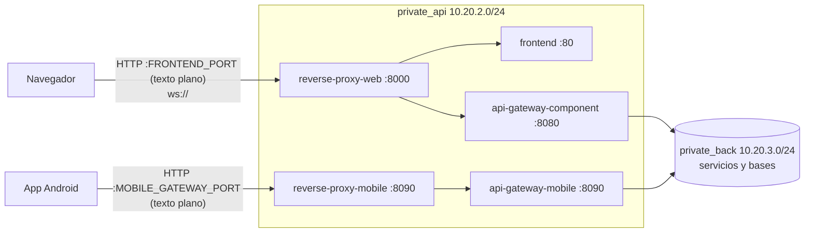
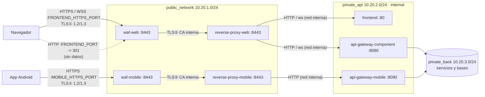

# Prototype 3 · Escenario de seguridad 1: Secure Channel (TLS) con WAF

Despliegue único: `docker compose up --build -d`. `compose.yaml` pone dos **WAF** (ModSecurity + OWASP CRS,
`waf-web` y `waf-mobile`) delante de los dos **reverse proxies**, con TLS en los dos tramos:

```
Navegador ══TLS① (cert. público)══► waf-web:8443    ══TLS② (CA interna)══► reverse-proxy-web:8443    ──► frontend / gateway web
Android   ══TLS① (cert. público)══► waf-mobile:8443 ══TLS② (CA interna)══► reverse-proxy-mobile:8443 ──► gateway móvil
```

Solo los WAF publican puertos. Hasta el commit `e73c221` el WAF iba en un archivo aparte
(`Backend/waf/compose.waf.yaml`) y existía un "modo directo" con los proxies publicados; ese archivo y ese modo
ya no existen.

## 1. Escenario de seguridad

| Elemento | Valor |
|---|---|
| **Fuente** | Atacante en la misma red que el cliente (Wi-Fi pública o compartida, red del campus) o en el camino de red: puede escuchar (pasivo) o interponerse (activo, *man-in-the-middle*). |
| **Estímulo** | Intercepta o modifica el tráfico entre el cliente (navegador o app Android) y el sistema para robar credenciales, la cookie `session` o el JWT, leer o alterar partidas, o suplantar al servidor. |
| **Entorno** | Operación normal; el cliente accede por una red pública no confiable. |
| **Artefacto** | Canal cliente → sistema: entradas `waf-web` (páginas, REST `/api/*`, WebSocket `/api/ws/*`) y `waf-mobile` (REST de la app), y el tramo WAF → reverse proxy. |
| **Respuesta** | Todo dato de la aplicación viaja cifrado y con integridad (TLS 1.2/1.3). El cliente autentica al WAF con su certificado y el WAF autentica al proxy con una CA interna. El HTTP en claro no transporta datos: el WAF responde 301 a HTTPS sin reenviar nada. La cookie de sesión solo se envía por HTTPS (`Secure`). |
| **Medida de la respuesta** | 100 % de las peticiones con datos sobre TLS ≥ 1.2. 0 conexiones aceptadas con TLS 1.0/1.1. 0 conexiones completadas con certificado no confiable o nombre incorrecto, tanto en el cliente como en el WAF. 0 peticiones HTTP que lleguen al proxy o al gateway. La cookie `session` siempre con `Secure; HttpOnly; SameSite=Lax`. Lo mide `verificar_canal_seguro.py` (sección 9). |

## 2. Problema que se resuelve

Hasta el Prototype 2 las dos entradas escuchaban solo HTTP (`:8000` web y `:8090` móvil). En una red no
confiable un atacante podía:

- leer usuario y contraseña en `POST /api/auth/login` y `/auth/register`;
- copiar la cookie `session` (web) o el `accessToken` (app) y suplantar al usuario hasta que vence (1 h);
- leer y modificar las jugadas del WebSocket `ws://` en vivo;
- hacerse pasar por el servidor: sin certificado, el cliente no puede distinguir el sistema real de uno falso.

El reverse proxy (escenario 2) y la segmentación de red (escenario 3) protegen lo que hay **detrás** de la
entrada, pero no el tramo **cliente → entrada**, que cruza redes que no controlamos.

## 3. Secure Channel Pattern y por qué

*Secure Channel* establece un canal que garantiza **confidencialidad**, **integridad** y **autenticación del
servidor** entre dos extremos sobre una red insegura. Se implementa con TLS:

- **Estándar y soportado por todos los clientes**: navegadores (HTTPS/WSS), OkHttp en Android y las
  bibliotecas de pruebas. No hace falta código criptográfico propio.
- **Punto natural de terminación**: la entrada pública. El WAF tiene que terminar TLS para poder inspeccionar
  la petición (no se inspecciona tráfico cifrado), y vuelve a cifrar hacia el proxy.
- **Separación de responsabilidades**: Nginx (del WAF y de los proxies) hace el TLS. El gateway solo marca la
  cookie como `Secure` (`COOKIE_SECURE=true`) y acepta el origen `https://` (`WS_ALLOWED_ORIGINS`).
- **Alternativas descartadas**: TLS en cada microservicio (mTLS) cifraría también la red interna, pero exige
  certificados por servicio y cambios en todos ellos (sección 7). Cifrar en la aplicación sería código propio,
  frágil y sin autenticación del servidor estándar.

## 4. Tácticas arquitectónicas aplicadas (resistir ataques)

| Táctica | Cómo se aplica |
|---|---|
| **Cifrar datos** | TLS 1.2/1.3 con suites ECDHE + AEAD (AES-GCM, ChaCha20-Poly1305) en los dos tramos; secreto perfecto hacia adelante. |
| **Autenticar actores** | Cliente → WAF: certificado X.509 de una CA en la que confía el cliente (cadena y SAN). WAF → proxy: certificado de una CA interna, con el nombre del servicio verificado. |
| **Mantener la integridad** | AEAD de TLS: cualquier modificación en tránsito rompe la conexión. |
| **Limitar la exposición** | Solo los WAF publican puertos. HTTP sin datos (301). TLS 1.0/1.1 deshabilitados y sin *session tickets*. |
| **Limitar el acceso** (a la sesión) | Cookie `Secure; HttpOnly; SameSite=Lax`. HSTS (configurable) para que el navegador no vuelva a intentar HTTP. |
| **Detectar y resistir ataques** (WAF) | ModSecurity + OWASP CRS en modo bloqueo inspecciona URL, cabeceras y cuerpo JSON (sección 11). |

## 5. Arquitectura anterior y resultante

**Antes** (escenarios 2 y 3, sin cifrado en el borde):



**Ahora:**



| Contenedor | Redes (IP fija) | Puertos publicados |
|---|---|---|
| `waf-web` | `public_network` (`10.20.1.13`) | `FRONTEND_PORT:8080` (HTTP, solo 301) y `FRONTEND_HTTPS_PORT:8443` |
| `waf-mobile` | `public_network` (`10.20.1.14`) | `MOBILE_HTTPS_PORT:8443` (el HTTP móvil no se publica) |
| `reverse-proxy-web` | `public_network` (`10.20.1.11`), `private_api` (`10.20.2.10`) | ninguno |
| `reverse-proxy-mobile` | `public_network` (`10.20.1.12`), `private_api` (`10.20.2.11`) | ninguno |

Los WAF solo están en `public_network`: no ven al frontend, a los gateways ni a ningún servicio; solo a los
proxies. Los proxies son el único paso hacia `private_api`.

| Entrada | Antes | Ahora |
|---|---|---|
| Web | `http://host:FRONTEND_PORT` (`:8000`) | `https://host:FRONTEND_HTTPS_PORT` (`:8443`); `FRONTEND_PORT` queda solo para redirigir |
| WebSocket | `ws://…/api/ws/*` | `wss://…/api/ws/*` (el frontend elige `wss` solo cuando la página es `https:`) |
| Android | `http://host:MOBILE_GATEWAY_PORT` (`:8090`) | `https://host:MOBILE_HTTPS_PORT` (`:8444`) |

## 6. Componentes y archivos

| Archivo | Qué hace |
|---|---|
| `compose.yaml` | Define `waf-web` y `waf-mobile` (variables de TLS, ModSecurity, métodos permitidos, certificado público y CA interna montados en solo lectura). Los proxies no publican puertos, montan su certificado **interno** (`INTERNAL_WEB_TLS_DIR`, `INTERNAL_MOBILE_TLS_DIR`) y `real-ip.conf`. |
| `Backend/waf/real-ip.conf` | El proxy solo acepta `X-Real-IP` si viene de un WAF (`10.20.1.13`, `10.20.1.14`). |
| `Backend/reverse-proxy/nginx/common.conf` | Política TLS común: `ssl_protocols TLSv1.2 TLSv1.3`, cifrados ECDHE+AEAD, sin *session tickets*, caché de sesión. |
| `Backend/reverse-proxy/nginx/web.conf.template` | Server TLS `:8443` (WebSocket `Upgrade`/`Connection`, bloqueo de `/api/internal`, `X-User-Id` vaciado, rate limit, HSTS). Server HTTP `:8000`: solo `/health` (healthcheck), páginas → 308 y `/api/*` → 403 `HTTPS_REQUIRED`; no se publica. |
| `Backend/reverse-proxy/nginx/mobile.conf.template` | Server TLS `:8443` con las mismas rutas. HTTP `:8090` solo `/health`, sin publicar. |
| `Backend/reverse-proxy/Dockerfile` | Plantillas en `/etc/nginx/templates` (`envsubst` filtrado a `PUBLIC_HTTPS_PORT` y `HSTS_MAX_AGE`); `EXPOSE 8443`. Los certificados no van en la imagen. |
| `.env.example` | Puertos HTTPS, `HSTS_MAX_AGE`, rutas de certificados; `COOKIE_SECURE` y `WS_ALLOWED_ORIGINS` para HTTPS. |
| `.gitignore` | `certs/`, `*.key`, `*.pem`, `*.crt`, `*.p12` y `*.pfx` nunca se suben. |
| `mobile/app/build.gradle.kts` | `BASE_URL` HTTPS en debug (`https://10.0.2.2:8444/`) y en release; el build falla si la URL no es `https://`. |
| `mobile/app/src/debug/res/xml/network_security_config.xml` | Debug: sin HTTP en claro; confía en las CA del sistema y en las instaladas por el usuario (la CA de desarrollo). |
| `mobile/app/src/main/res/xml/network_security_config.xml` | Release: sin HTTP en claro; solo CA del sistema. |
| `Backend/reverse-proxy/secure-channel/generar_certs_internos.py` | CA interna y certificados de los proxies. |
| `Backend/reverse-proxy/secure-channel/validar_config.py` | Validación estática (sin Docker). |
| `Backend/reverse-proxy/secure-channel/verificar_canal_seguro.py` | Verificación contra el stack en Docker; genera `resultados-canal-seguro.json`. |
| `Backend/reverse-proxy/escenarios/medir_resistencia.py` | Escenario 2 (fuerza bruta, rutas internas, suplantación) medido a través de los WAF por HTTPS. |

**Sin cambios:** la lógica de Auth, Game Logic, Multiplayer, Single Player, Tutor, Botcito y los gateways
(el gateway ya leía `COOKIE_SECURE` y `WS_ALLOWED_ORIGINS`) y el frontend (ya usa `wss` cuando la página es
`https:`).

## 7. Alcance real del cifrado y limitaciones

- **Protege:** cliente ↔ WAF y WAF ↔ reverse proxy (web, REST, WebSocket y app). El primer tramo es el que
  cruza redes no confiables.
- **No protege (no es cifrado extremo a extremo):** reverse proxy → frontend/gateways → microservicios →
  bases de datos y RabbitMQ siguen con sus protocolos actuales (HTTP, `ws://`, AMQP, Mongo, MySQL,
  PostgreSQL) **sin cifrar**, dentro de las redes internas (`private_api` y `private_back` son
  `internal: true`). Su protección es la segmentación del escenario 3. Cifrarlo requeriría mTLS entre
  servicios (o una *service mesh*), con certificados por servicio y cambios en cada cliente.
- **El WAF y el proxy ven el tráfico en claro**: los dos terminan TLS. Son piezas de confianza; la clave del
  certificado público (en el WAF) es el secreto más sensible del despliegue.
- **Certificados de desarrollo**: la CA de mkcert solo es confiable en las máquinas donde se instaló. En
  producción se necesita un dominio y una CA pública (sección 8.4).
- **HSTS en `localhost`** queda en `0`: un HSTS largo en `localhost` afectaría a cualquier otro servidor
  local del desarrollador. En producción: `HSTS_MAX_AGE=31536000`.
- **El HTTP `:FRONTEND_PORT` sigue publicado**, pero solo responde 301. Un primer acceso tecleando `http://`
  puede ser interceptado antes de la redirección; HSTS en producción lo evita en los siguientes.
- **No hay *certificate pinning* en Android**: se confía en la CA (del sistema en release). Es lo
  recomendado salvo requisitos especiales; el *pinning* complica la rotación de certificados.

## 8. Procedimiento de despliegue (Windows, Docker Desktop, PowerShell)

### 8.1 Certificados

```powershell
# 1. Certificado público de desarrollo (mkcert) para los WAF, en certs\edge
winget install FiloSottile.mkcert          # o: choco install mkcert
mkcert -install                            # crea la CA local y la añade a la confianza de Windows (pide confirmación)
New-Item -ItemType Directory -Force certs\edge | Out-Null
mkcert -cert-file certs\edge\tls.crt -key-file certs\edge\tls.key localhost 127.0.0.1 ::1 10.0.2.2
mkcert -CAROOT                             # carpeta de rootCA.pem (para pruebas y Android)

# 2. CA interna y certificados de los proxies en certs\internal (no sobrescribe lo existente)
pip install cryptography
python Backend\reverse-proxy\secure-channel\generar_certs_internos.py --control-negativo
```

- `10.0.2.2` es el PC visto desde el emulador de Android. Para entrar desde otro equipo de la red, añade la IP
  del PC al primer `mkcert` (y a `WS_ALLOWED_ORIGINS`).
- `certs/` está en `.gitignore`. **Nunca compartas `rootCA-key.pem`** (la clave de la CA de mkcert) ni
  `certs/internal/ca/ca.key`.
- Firefox usa su propio almacén: `mkcert -install` lo cubre si tiene NSS; si no, importa `rootCA.pem` en
  Firefox (Ajustes → Privacidad → Certificados).
- En Linux/macOS, la imagen de los proxies corre como uid 101: las claves deben poder leerse
  (`chmod 644` en desarrollo o `sudo chown 101`). En Docker Desktop para Windows no hace falta.

### 8.2 Variables de entorno

**No sobrescribas tu `.env`**. Este bloque solo añade las variables que falten:

```powershell
$nuevas = [ordered]@{ FRONTEND_PORT='8080'; FRONTEND_HTTPS_PORT='8443'; MOBILE_HTTPS_PORT='8444'; HSTS_MAX_AGE='0'
  EDGE_TLS_DIR='./certs/edge'; INTERNAL_CA_CERT='./certs/internal/ca/ca.crt'
  INTERNAL_WEB_TLS_DIR='./certs/internal/reverse-proxy-web'; INTERNAL_MOBILE_TLS_DIR='./certs/internal/reverse-proxy-mobile' }
$actual = if (Test-Path .env) { Get-Content .env } else { @() }
foreach ($k in $nuevas.Keys) { if (-not ($actual -match "^$k=")) { Add-Content .env "$k=$($nuevas[$k])"; "añadida $k" } }
```

Después edita a mano en `.env` estas dos (no se imprimen secretos):

```
COOKIE_SECURE=true
WS_ALLOWED_ORIGINS=https://localhost:8443
```

`MOBILE_GATEWAY_PORT`, `WEB_TLS_DIR` y `MOBILE_TLS_DIR` ya no se usan. Para los puertos estándar:
`FRONTEND_PORT=80`, `FRONTEND_HTTPS_PORT=443` y `WS_ALLOWED_ORIGINS=https://localhost`.

### 8.3 Arrancar y comprobar

```powershell
pip install crossplane pyyaml
python Backend\reverse-proxy\secure-channel\validar_config.py   # 85/85, sin Docker
docker compose config --quiet; "config: $LASTEXITCODE"           # 0 = válido
docker compose up --build -d
docker compose ps -a                                             # todo healthy, incluidos waf-web y waf-mobile
docker compose exec reverse-proxy-web nginx -t                   # sintaxis + certificado interno cargado
docker compose exec waf-web nginx -T | Select-String 'proxy_ssl_verify|proxy_ssl_trusted|proxy_pass https'
```

Abre `https://localhost:8443`: candado sin advertencias. `http://localhost:8080` debe redirigir.

- En un primer arranque con la máquina cargada, algún servicio puede quedar `unhealthy` por tardar más que su
  `start_period`; vuelve a ejecutar `docker compose up -d` (sin `--build`).
- Si vienes de una versión con el WAF en un archivo aparte, borra la red que quedó sin uso:
  `docker network rm insightfulgames_waf-edge`.

### 8.4 Despliegue real (dominio y CA pública)

1. Dominio (p. ej. `juego.tu-dominio.com` y `api.tu-dominio.com`) apuntando al servidor.
2. Certificado de una CA pública, p. ej. Let's Encrypt con `certbot certonly --standalone -d …`.
   Copia `fullchain.pem` → `tls.crt` y `privkey.pem` → `tls.key` en un directorio propio fuera del
   repositorio y apunta `EDGE_TLS_DIR` a él. Los certificados internos de los proxies siguen siendo los de la
   CA interna.
3. `.env`: `FRONTEND_PORT=80`, `FRONTEND_HTTPS_PORT=443`, `HSTS_MAX_AGE=31536000`, `COOKIE_SECURE=true` y
   `WS_ALLOWED_ORIGINS=https://juego.tu-dominio.com`.
4. Renovación: reemplaza los archivos y ejecuta `docker compose restart waf-web waf-mobile`.
5. Android release: `.\gradlew assembleRelease -PinsightfulReleaseBaseUrl=https://api.tu-dominio.com/`. El
   build falla si la URL no es `https://`.

### 8.5 Android en el emulador (debug)

```powershell
adb push "$(mkcert -CAROOT)\rootCA.pem" /sdcard/Download/insightful-dev-ca.pem
```

En el emulador: Ajustes → Seguridad (o Seguridad y privacidad) → Cifrado y credenciales → Instalar un
certificado → **Certificado de CA** → `insightful-dev-ca.pem`. Compila e instala la variante debug
(`BASE_URL=https://10.0.2.2:8444/`, que llega a `waf-mobile`). Para un dispositivo físico:
`.\gradlew installDebug -PinsightfulDebugBaseUrl=https://<IP-del-PC>:8444/`, generando el certificado con esa IP.

La variante **debug** confía en las CA instaladas por el usuario; la **release** solo en las del sistema.
Ninguna acepta certificados arbitrarios: no hay `TrustManager` permisivo ni se desactiva la verificación
de nombre.

## 9. Pruebas

```powershell
pip install "websockets<14" httpx
$env:TLS_CA_FILE = "$(mkcert -CAROOT)\rootCA.pem"
$env:FRONTEND_PORT = '8080'; $env:FRONTEND_HTTPS_PORT = '8443'; $env:MOBILE_HTTPS_PORT = '8444'
python Backend\reverse-proxy\secure-channel\verificar_canal_seguro.py
python Backend\reverse-proxy\secure-channel\verificar_canal_seguro.py --control-negativo-upstream
python Backend\reverse-proxy\escenarios\medir_resistencia.py
```

`verificar_canal_seguro.py` usa la API `extra_headers` de `websockets`, que cambió de nombre en la versión 14;
de ahí el `"websockets<14"` (el gateway del proyecto usa la 12). Escribe `resultados-canal-seguro.json`.

| Prueba | Qué comprueba | Resultado (2026-11-24, Docker Desktop) |
|---|---|---|
| `validar_config.py` | Plantillas renderizadas como en la imagen y analizadas con crossplane (estricto); política TLS; `compose.yaml`: solo los WAF publican, variables del WAF existentes en la imagen, verificación del tramo interno, redes e IP, `real-ip.conf`, nada de certificados en Git | **85/85** |
| `verificar_canal_seguro.py` | TLS 1.2/1.3 aceptados y 1.0/1.1 rechazados (web y móvil); certificado no confiable y nombre incorrecto rechazados; HSTS; registro, login y cookie `Secure; HttpOnly; SameSite=Lax`; petición autenticada; partida por **WSS** y WSS desde `http://` → 4403; `PATCH` y `DELETE` permitidos; `/internal` → 404 o 403; login de la app; puertos internos cerrados; `nginx -T` de los WAF; tramo WAF → proxy validado con la CA interna; HTTP del WAF → 301 sin llegar al proxy; SQLi/XSS/PUT → 403 de CRS; IP real; redes | **84/84** |
| … `--control-negativo-upstream` | Recrea `reverse-proxy-web` con un certificado de otra CA y con uno de la CA interna con otro nombre: el WAF responde 502 y registra el motivo; al restaurarlo vuelve a 200 | **87/87** (las 84 + 3) |
| Batería de ataques a través de los WAF | SQLi (query, cuerpo JSON, UNION, time-based), XSS (query, JSON, `javascript:`), path traversal y LFI, inyección de comandos, PHP, Log4Shell, escáneres (sqlmap, Nikto), archivos sensibles (`.env`, `.git`), métodos no permitidos, Content-Type no permitido, SSRF, NoSQL | **49/49 detenidos en el WAF** (44 por CRS con 403; 5 por el Nginx del WAF con 400/405); ninguno aparece en los logs de proxies ni gateways |
| Tráfico legítimo a través de los WAF | Páginas, estáticos, registro/login (contraseñas con `'`, `--`, `<>`, `&`, `1=1`), partida contra el bot por WSS, rendición, `PATCH`, tutor, partida local en el móvil, `DELETE` de cuenta | **32/32 sin falsos positivos** |

Comprobaciones manuales complementarias:

```powershell
# Protocolos (OpenSSL de Git for Windows)
openssl s_client -connect localhost:8443 -tls1_1 -CAfile "$(mkcert -CAROOT)\rootCA.pem" </dev/null   # debe fallar
openssl s_client -connect localhost:8443 -tls1_3 -CAfile "$(mkcert -CAROOT)\rootCA.pem" </dev/null   # Verify return code: 0 (ok)
# HTTP del WAF
curl.exe -sI http://localhost:8080/estadisticas            # 301, Location: https://localhost:8443/estadisticas
```

- **Navegador:** inicia sesión en `https://localhost:8443`, abre DevTools → Application → Cookies (`session`
  con *Secure* marcado) → Network → WS (`wss://localhost:8443/api/ws/games/…`) y juega una partida local, una
  contra Botcito y una multijugador.
- **Android:** con la CA instalada, inicia sesión en la app. Quita la CA (Ajustes → Credenciales de usuario)
  y repite: debe fallar con error de certificado (prueba de que no se acepta cualquier certificado).

## 10. Evidencia para el informe y la exposición

1. `Backend/reverse-proxy/secure-channel/resultados-canal-seguro.json` (fecha, versión de OpenSSL, cada
   prueba con su resultado) y la salida de consola de `verificar_canal_seguro.py`.
2. Salida de `validar_config.py` (85/85) y de `docker compose exec reverse-proxy-web nginx -t`.
3. Capturas: candado y certificado en el navegador; DevTools → Security (TLS 1.3, cifrado); cookie `session`
   con *Secure*; frames WebSocket en `wss://`.
4. `openssl s_client` con `-tls1_1` rechazado y con `-tls1_3` aceptado.
5. `curl.exe -sI http://…` mostrando el 301.
6. El control negativo: el WAF responde 502 ante un proxy con certificado falso.
7. Escenario 2 (`medir_resistencia.py`) a través del WAF: las protecciones del proxy se mantienen.
8. Android: login correcto con la CA instalada y fallo al quitarla.
9. Opcional (muy ilustrativo): captura de Wireshark del puerto 8443 (solo `TLSv1.3 Application Data`)
   frente a la del Prototype 2 en HTTP (credenciales visibles).

## 11. El WAF

### 11.1 Dónde termina cada canal

- **TLS①** termina en el WAF: es necesario para que ModSecurity vea la petición HTTP. **TLS②** es una
  conexión nueva del WAF al proxy, dentro de `public_network`.
- Los proxies conservan su función: mismas rutas, bloqueo de `/internal`, `X-User-Id` vaciado, rate limit y
  cabeceras WebSocket. Presentan el certificado **interno**.

### 11.2 Configuración (verificada contra el código de la imagen)

Todo está en `compose.yaml` (servicios `waf-web` y `waf-mobile`, anclas `x-waf-tls-env`, `x-edge-cert` y
`x-internal-ca`). Las variables se comprobaron en `coreruleset/modsecurity-crs-docker` (`nginx/Dockerfile`,
`templates/includes/proxy_backend_ssl.conf.template`, `docker-entrypoint.d/93-update-proxy-ssl-config.sh`,
`src/bin/check-proxy-client-cert`):

| Variable | Valor | Efecto en el Nginx del WAF |
|---|---|---|
| `MODSEC_RULE_ENGINE` | `On` | modo bloqueo (no solo detección); paranoia 1 y umbral de anomalía 5, los de la imagen |
| `MODSEC_AUDIT_ENGINE`, `MODSEC_AUDIT_LOG` | `RelevantOnly`, `/dev/stdout` | las peticiones bloqueadas quedan en `docker compose logs waf-web` con el id de la regla |
| `SSL_CERT_FILE` / `SSL_CERT_KEY_FILE` | `/etc/nginx/edge-certs/tls.*` (montaje de solo lectura de `EDGE_TLS_DIR`) | certificado público; sin esto la imagen genera uno autofirmado sin SAN, que los clientes rechazan |
| `SSL_PROTOCOLS`, `SSL_CIPHERS` | `TLSv1.2 TLSv1.3`; ECDHE+AEAD | misma política que `common.conf` |
| `NGINX_ALWAYS_TLS_REDIRECT`, `SSL_REDIRECT_PORT` | `on`, puerto HTTPS público | todo el HTTP recibe 301 antes de llegar a ModSecurity o al proxy |
| `BACKEND` | `https://reverse-proxy-{web,mobile}:8443` | `proxy_pass` por TLS |
| `PROXY_SSL`, `PROXY_SSL_VERIFY`, `PROXY_SSL_SERVER_NAME` | `on` | `proxy_ssl_verify on`, SNI; el nombre verificado es el host de `BACKEND` |
| `PROXY_SSL_CA_CERT_FILE` | `/etc/nginx/upstream-ca/ca.crt` (de `INTERNAL_CA_CERT`) | `proxy_ssl_trusted_certificate`: **solo** la CA interna |
| `PROXY_SSL_PROTOCOLS`, `PROXY_SSL_CIPHERS`, `PROXY_SSL_VERIFY_DEPTH` | `TLSv1.2 TLSv1.3`; ECDHE+AEAD; `1` | política del tramo interno |
| `SSL_OCSP_STAPLING` | `off` | los certificados de desarrollo no tienen respondedor OCSP |

**mTLS no hace falta:** con `PROXY_SSL=on` y sin `proxy.crt`/`proxy.key` en las rutas por defecto,
`check-proxy-client-cert` devuelve `no-cert` y la imagen verifica el upstream sin certificado de cliente.

**Validación del nombre:** Nginx usa como nombre del upstream el host de `proxy_pass` (sin el puerto), es
decir `reverse-proxy-web`; el certificado interno tiene exactamente ese SAN.

### 11.3 Certificados: público e interno separados

| Certificado | Quién lo presenta | Firmado por | SAN | Quién confía |
|---|---|---|---|---|
| Público de desarrollo (`certs/edge/`) | `waf-web`, `waf-mobile` | CA de **mkcert** (instalada en Windows, navegador y emulador) | `localhost`, `127.0.0.1`, `::1`, `10.0.2.2` | navegador, Android, scripts (`TLS_CA_FILE`) |
| Interno web (`certs/internal/reverse-proxy-web/`) | `reverse-proxy-web` | **CA interna** (no instalada en ningún almacén) | `reverse-proxy-web` | solo `waf-web` (`ca.crt`) y el cliente interno de `medir_resistencia.py` |
| Interno móvil (`certs/internal/reverse-proxy-mobile/`) | `reverse-proxy-mobile` | CA interna | `reverse-proxy-mobile` | solo `waf-mobile` |

- Un certificado por proxy: el de la web no sirve para suplantar al móvil (nombre distinto).
- La CA interna la genera `generar_certs_internos.py` (EC P-256, `CA:TRUE, pathlen:0`; hojas `serverAuth`,
  397 días). Al WAF solo se le monta `ca/ca.crt`; `ca/ca.key` no se monta en ningún contenedor.
- Con la CA interna separada, la CA de mkcert (en la que confía el navegador) no permite suplantar a un proxy
  ante el WAF, y la CA interna no permite suplantar al sistema ante los clientes.

### 11.4 IP real, cabeceras y WebSocket a través del WAF

- **IP real:** el WAF envía `X-Real-IP: $remote_addr` (sobrescribe lo que mande el cliente) y el proxy solo
  cree esa cabecera si viene de `10.20.1.13` o `10.20.1.14` (`Backend/waf/real-ip.conf`). Sin
  `real-ip.conf`, el rate limit de login sería global (todas las peticiones con la IP del WAF).
- **Limitación en Docker Desktop:** el WAF no ve la IP del cliente real sino la de la red de Docker
  (`10.20.1.1`), así que en pruebas locales el límite de login por IP se comporta como global. En un servidor
  Linux con los puertos publicados por Docker se conserva la IP de origen.
- **Host:** el WAF envía `Host: $host` (sin puerto). Ningún componente lo usa para construir URL (el gateway
  compara `Origin` con `WS_ALLOWED_ORIGINS`); `X-Forwarded-Proto` llega como `https`.
- **WebSocket:** la imagen reenvía `Upgrade`/`Connection`, usa HTTP/1.1 y `proxy_read_timeout 36000s`; el
  proxy hace lo mismo hacia el gateway. ModSecurity inspecciona el *handshake*, **no** los mensajes del
  WebSocket (las jugadas).
- **HSTS:** lo emite el proxy y atraviesa el WAF; las respuestas generadas por el propio WAF (301, 403 de
  CRS) no lo llevan.
- **Healthchecks:** el de la imagen del WAF es `curl -sk https://localhost:8443/healthz` (solo vida del
  proceso: usa `-k` y no cuenta como evidencia TLS). Los WAF esperan a que los proxies estén *healthy*.

### 11.5 Métodos PATCH y DELETE (aprobados por el responsable del WAF)

CRS solo permite `GET HEAD POST OPTIONS` (regla 900200); la 911100 (nivel 1, crítica) bloquea el resto, pero
el sistema usa `DELETE /api/auth/account`, `PATCH /api/games/{id}/visibility`,
`PATCH /api/matches/{id}/visibility` y `DELETE /auth/account` (app). `compose.yaml` fija `ALLOWED_METHODS`:
`GET HEAD POST OPTIONS PATCH DELETE` en `waf-web` y `GET HEAD POST OPTIONS DELETE` en `waf-mobile` (el gateway
móvil no tiene rutas `PATCH`). No desactiva reglas ni cambia paranoia o umbrales; `PUT`, `TRACE`, `CONNECT`…
siguen bloqueados.

### 11.6 Límites del WAF

- **Paranoia 1:** detecta los ataques comunes con muy pocos falsos positivos (0 en las pruebas), pero deja pasar
  variantes más ofuscadas que los niveles 2–4 sí detectarían, a costa de más falsos positivos.
- **`TRACE` y el *path traversal* por encima de la raíz** los rechaza el Nginx del WAF (405/400) antes de
  ModSecurity: no pasan del borde, pero no quedan en el log de auditoría de CRS.
- **Mensajes del WebSocket** no se inspeccionan (sección 11.4).
