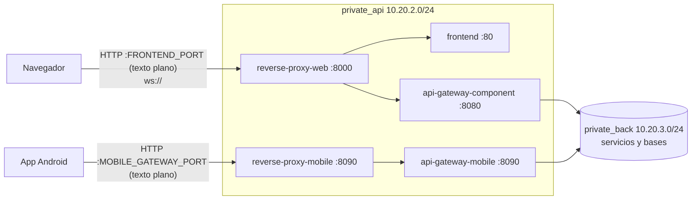
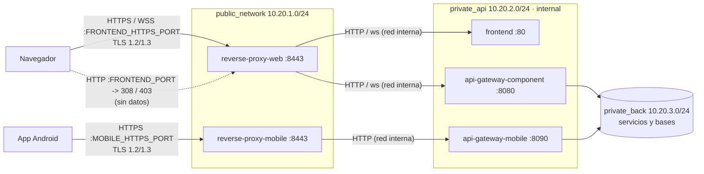

# Prototype 3 · Escenario de seguridad 1: Secure Channel (TLS)

Rama: `feature/secure-channel-tls`, sobre `daniel/reverse-proxy` (`c01a872`): dos reverse proxies
separados y redes `public_network` / `private_api` / `private_back`.

## 1. Escenario de seguridad

| Elemento | Valor |
|---|---|
| **Fuente** | Atacante en la misma red que el cliente (Wi-Fi pública o compartida, red del campus) o en el camino de red: puede escuchar (pasivo) o interponerse (activo, *man-in-the-middle*). |
| **Estímulo** | Intercepta o modifica el tráfico entre el cliente (navegador o app Android) y el sistema para robar credenciales, la cookie `session` o el JWT, leer o alterar partidas, o suplantar al servidor. |
| **Entorno** | Operación normal; el cliente accede por una red pública no confiable. |
| **Artefacto** | Canal cliente → sistema: entradas `reverse-proxy-web` (páginas, REST `/api/*`, WebSocket `/api/ws/*`) y `reverse-proxy-mobile` (REST de la app). |
| **Respuesta** | Todo dato de la aplicación viaja cifrado y con integridad (TLS 1.2/1.3). El cliente autentica al servidor con su certificado. El HTTP en claro no transporta datos: las páginas redirigen a HTTPS y la API responde 403. La cookie de sesión solo se envía por HTTPS (`Secure`). |
| **Medida de la respuesta** | 100 % de las peticiones con datos sobre TLS ≥ 1.2. 0 conexiones aceptadas con TLS 1.0/1.1. 0 conexiones completadas con certificado no confiable o nombre incorrecto. 0 respuestas de la API por HTTP. La cookie `session` siempre con `Secure; HttpOnly; SameSite=Lax`. Lo mide `verificar_canal_seguro.py` (sección 9). |

## 2. Problema que se resuelve

Hasta el Prototype 2 las dos entradas escuchaban solo HTTP (`:8000` web y `:8090` móvil). En una red no
confiable un atacante podía:

- leer usuario y contraseña en `POST /api/auth/login` y `/auth/register`;
- copiar la cookie `session` (web) o el `accessToken` (app) y suplantar al usuario hasta que vence (1 h);
- leer y modificar las jugadas del WebSocket `ws://` en vivo;
- hacerse pasar por el servidor: sin certificado, el cliente no puede distinguir el sistema real de uno falso.

El reverse proxy (escenario 2) y la segmentación de red (escenario 3) protegen lo que hay **detrás** de la
entrada, pero no el tramo **cliente → entrada**, que cruza redes que no controlamos.

## 3. Secure Channel Pattern y por qué

*Secure Channel* establece un canal que garantiza **confidencialidad**, **integridad** y **autenticación del
servidor** entre dos extremos sobre una red insegura. Se implementa con TLS:

- **Estándar y soportado por todos los clientes**: navegadores (HTTPS/WSS), OkHttp en Android y las
  bibliotecas de pruebas. No hace falta código criptográfico propio.
- **Punto natural de terminación**: los reverse proxies ya son la única puerta pública. Terminar TLS ahí
  protege a la vez la web, la API, el WebSocket y la app, sin tocar microservicios ni crear uno nuevo.
- **Separación de responsabilidades**: Nginx hace el TLS. El gateway solo marca la cookie como `Secure`
  (`COOKIE_SECURE=true`) y acepta el origen `https://` (`WS_ALLOWED_ORIGINS`), que ya eran configurables.
- **Alternativas descartadas**: TLS en cada microservicio (mTLS) cifraría también la red interna, pero exige
  certificados por servicio y cambios en todos ellos (sección 7). Cifrar en la aplicación sería código propio,
  frágil y sin autenticación del servidor estándar.

## 4. Tácticas arquitectónicas aplicadas (resistir ataques)

| Táctica | Cómo se aplica |
|---|---|
| **Cifrar datos** | TLS 1.2/1.3 con suites ECDHE + AEAD (AES-GCM, ChaCha20-Poly1305); secreto perfecto hacia adelante. |
| **Autenticar actores** (al servidor) | Certificado X.509 firmado por una CA en la que confía el cliente; se verifican cadena y nombre (SAN). |
| **Mantener la integridad** | AEAD de TLS: cualquier modificación en tránsito rompe la conexión. |
| **Limitar la exposición** | HTTP sin datos: `/api/*` → 403 y páginas → 308. El HTTP del proxy móvil ya no se publica. TLS 1.0/1.1 deshabilitados y sin *session tickets*. |
| **Limitar el acceso** (a la sesión) | Cookie `Secure; HttpOnly; SameSite=Lax`. HSTS (configurable) para que el navegador no vuelva a intentar HTTP. |

## 5. Arquitectura anterior y resultante

**Antes** (escenarios 2 y 3, sin cifrado en el borde):



**Después** (este escenario):



Se conservan las redes, las IP fijas (`10.20.1.11/12`, `10.20.2.10/11`), el enrutamiento por ruta y la
separación web/móvil. Solo los dos proxies publican puertos.

| Entrada | Antes | Después |
|---|---|---|
| Web | `http://host:FRONTEND_PORT` (`:8000`) | `https://host:FRONTEND_HTTPS_PORT` (`:8443`); `FRONTEND_PORT` queda solo para redirigir |
| WebSocket | `ws://…/api/ws/*` | `wss://…/api/ws/*` (el frontend elige `wss` solo cuando la página es `https:`) |
| Android | `http://host:MOBILE_GATEWAY_PORT` (`:8090`) | `https://host:MOBILE_HTTPS_PORT` (`:8443`); el `:8090` ya no se publica |

## 6. Componentes y archivos modificados

| Archivo | Cambio |
|---|---|
| `Backend/reverse-proxy/nginx/common.conf` | Política TLS común: `ssl_protocols TLSv1.2 TLSv1.3`, cifrados ECDHE+AEAD, sin *session tickets*, caché de sesión. |
| `Backend/reverse-proxy/nginx/web.conf.template` (antes `web.conf`) | Server TLS `:8443` con las mismas rutas y cabeceras (WebSocket `Upgrade`/`Connection`, bloqueo de `/api/internal`, `X-User-Id` vaciado, rate limit) más HSTS. Server HTTP `:8000`: `/health`, páginas → 308 y `/api/*` → 403 `HTTPS_REQUIRED`. |
| `Backend/reverse-proxy/nginx/mobile.conf.template` (antes `mobile.conf`) | Server TLS `:8443` con las mismas rutas. HTTP `:8090` solo `/health`, sin publicar. |
| `Backend/reverse-proxy/Dockerfile` | Plantillas en `/etc/nginx/templates` (las procesa `envsubst` de la imagen, filtrado a `PUBLIC_HTTPS_PORT` y `HSTS_MAX_AGE`); `EXPOSE 8443`. Los certificados no van en la imagen. |
| `compose.yaml` | Publica `FRONTEND_HTTPS_PORT:8443` y `MOBILE_HTTPS_PORT:8443`; monta `WEB_TLS_DIR` y `MOBILE_TLS_DIR` en `/etc/nginx/certs` en solo lectura y sin crear la ruta. |
| `.env.example` | Nuevas variables de TLS; `COOKIE_SECURE` y `WS_ALLOWED_ORIGINS` documentadas para HTTPS. |
| `.gitignore` | `certs/`, `*.key`, `*.pem`, `*.crt`, `*.p12` y `*.pfx` nunca se suben. |
| `mobile/app/build.gradle.kts` | `BASE_URL` HTTPS en debug (`https://10.0.2.2:8444/`) y en release; ambos configurables con propiedades de Gradle; el build falla si la URL no es `https://`. |
| `mobile/app/src/debug/res/xml/network_security_config.xml` | Debug: sin HTTP en claro; confía en las CA del sistema y en las instaladas por el usuario (la CA de desarrollo). |
| `mobile/app/src/main/res/xml/network_security_config.xml` | Release: sin HTTP en claro; solo CA del sistema (explícito). |
| `Backend/reverse-proxy/secure-channel/validar_config.py` | Validación estática (sin Docker). |
| `Backend/reverse-proxy/secure-channel/verificar_canal_seguro.py` | Verificación contra el stack en Docker; genera la evidencia en JSON. |
| `Backend/reverse-proxy/escenarios/medir_resistencia.py` | (Compatibilidad con el escenario 2) mide por HTTPS validando el certificado; `PROXY_SCHEME=http` conserva el modo anterior. |

**Sin cambios:** la lógica de Auth, Game Logic, Multiplayer, Single Player, Tutor, Botcito y los gateways
(el gateway ya leía `COOKIE_SECURE` y `WS_ALLOWED_ORIGINS`); el frontend (ya usa `wss` cuando la página es
`https:`); las redes Docker y el WAF (sigue comentado).

## 7. Alcance real del cifrado y limitaciones

- **Protege:** cliente ↔ reverse proxy (web, REST, WebSocket y app). Es el tramo que cruza redes no confiables.
- **No protege (no es cifrado extremo a extremo):** reverse proxy → frontend/gateways → microservicios →
  bases de datos y RabbitMQ siguen con sus protocolos actuales (HTTP, `ws://`, AMQP, Mongo, MySQL,
  PostgreSQL) **sin cifrar**, dentro de las redes Docker internas (`private_api` y `private_back` son
  `internal: true`). Su protección es la segmentación del escenario 3, no el cifrado. Si un contenedor
  interno se compromete, puede leer ese tráfico. Cifrarlo requeriría mTLS entre servicios (o una *service
  mesh*), con certificados por servicio y cambios en cada cliente HTTP, AMQP y de base de datos.
- **El proxy ve el tráfico en claro**: termina TLS. Es una pieza de confianza; su clave privada es el secreto
  más sensible del despliegue.
- **Certificados de desarrollo**: la CA de mkcert solo es confiable en las máquinas donde se instaló. En
  producción se necesita un dominio y una CA pública (sección 8).
- **HSTS en `localhost`** queda en `0`: un HSTS largo en `localhost` afectaría a cualquier otro servidor
  local del desarrollador. En producción: `HSTS_MAX_AGE=31536000`.
- **El HTTP `:FRONTEND_PORT` sigue publicado**, pero solo para redirigir páginas. Un primer acceso tecleando
  `http://` puede ser interceptado antes de la redirección; HSTS en producción lo evita en los siguientes.
- **No hay *certificate pinning* en Android**: se confía en la CA (del sistema en release). Es lo
  recomendado salvo requisitos especiales; el *pinning* complica la rotación de certificados.

## 8. Procedimiento de despliegue (Windows, Docker Desktop, PowerShell)

### 8.1 Certificado de desarrollo confiable (mkcert)

```powershell
winget install FiloSottile.mkcert          # o: choco install mkcert
mkcert -install                            # crea la CA local y la añade a la confianza de Windows y Chrome/Edge
New-Item -ItemType Directory -Force certs | Out-Null
mkcert -cert-file certs\tls.crt -key-file certs\tls.key `
  localhost 127.0.0.1 ::1 10.0.2.2 reverse-proxy-web reverse-proxy-mobile
mkcert -CAROOT                             # carpeta de rootCA.pem (para pruebas y Android)
```

- `10.0.2.2` es el PC visto desde el emulador de Android. `reverse-proxy-web` y `reverse-proxy-mobile` los
  usa la medición del escenario 2 desde dentro de la red Docker.
- `certs/` está en `.gitignore`. **Nunca compartas `rootCA-key.pem`** (la clave de la CA de mkcert).
- Firefox usa su propio almacén: `mkcert -install` lo cubre si tiene NSS; si no, importa `rootCA.pem` en
  Firefox (Ajustes → Privacidad → Certificados).
- En Linux/macOS, la imagen corre como uid 101: la clave debe poder leerla ese usuario
  (`chmod 644 certs/tls.key` en desarrollo o `sudo chown 101 certs/tls.key`). En Docker Desktop para Windows
  no hace falta.

### 8.2 Variables de entorno

**No sobrescribas tu `.env`**. Este bloque solo añade las variables que falten:

```powershell
$nuevas = [ordered]@{ FRONTEND_PORT='8080'; FRONTEND_HTTPS_PORT='8443'; MOBILE_HTTPS_PORT='8444'
                      WEB_TLS_DIR='./certs'; MOBILE_TLS_DIR='./certs'; HSTS_MAX_AGE='0' }
$actual = if (Test-Path .env) { Get-Content .env } else { @() }
foreach ($k in $nuevas.Keys) { if (-not ($actual -match "^$k=")) { Add-Content .env "$k=$($nuevas[$k])"; "añadida $k" } }
```

Después edita a mano en `.env` estas dos (no se imprimen secretos):

```
COOKIE_SECURE=true
WS_ALLOWED_ORIGINS=https://localhost:8443
```

`MOBILE_GATEWAY_PORT` ya no se usa (el HTTP del proxy móvil no se publica). Para usar los puertos estándar:
`FRONTEND_PORT=80`, `FRONTEND_HTTPS_PORT=443` y `WS_ALLOWED_ORIGINS=https://localhost`.

### 8.3 Arrancar y comprobar

```powershell
docker compose config --quiet; "config: $LASTEXITCODE"      # 0 = válido
docker compose up --build -d
docker compose ps -a                                         # reverse-proxy-web y -mobile: healthy
docker compose logs --tail=50 reverse-proxy-web reverse-proxy-mobile
docker compose exec reverse-proxy-web nginx -t               # sintaxis + certificados cargados
docker compose exec reverse-proxy-mobile nginx -t
```

Abre `https://localhost:8443`: candado sin advertencias. `http://localhost:8080` debe redirigir.

### 8.4 Despliegue real (dominio y CA pública)

1. Dominio (p. ej. `juego.tu-dominio.com` y `api.tu-dominio.com`) apuntando al servidor.
2. Certificado de una CA pública, p. ej. Let's Encrypt con `certbot certonly --standalone -d …`.
   Copia `fullchain.pem` → `tls.crt` y `privkey.pem` → `tls.key` en directorios propios por entrada y
   apunta `WEB_TLS_DIR` y `MOBILE_TLS_DIR` a ellos (permisos 600 y dueño 101, fuera del repositorio).
3. `.env`: `FRONTEND_PORT=80`, `FRONTEND_HTTPS_PORT=443`, `HSTS_MAX_AGE=31536000`, `COOKIE_SECURE=true` y
   `WS_ALLOWED_ORIGINS=https://juego.tu-dominio.com`.
4. Renovación: reemplaza los archivos y ejecuta `docker compose restart reverse-proxy-web reverse-proxy-mobile`.
5. Android release: `.\gradlew assembleRelease -PinsightfulReleaseBaseUrl=https://api.tu-dominio.com/`. El
   build falla si la URL no es `https://`.

### 8.5 Android en el emulador (debug)

```powershell
adb push "$(mkcert -CAROOT)\rootCA.pem" /sdcard/Download/insightful-dev-ca.pem
```

En el emulador: Ajustes → Seguridad (o Seguridad y privacidad) → Cifrado y credenciales → Instalar un
certificado → **Certificado de CA** → `insightful-dev-ca.pem`. Compila e instala la variante debug
(`BASE_URL=https://10.0.2.2:8444/`). Para un dispositivo físico:
`.\gradlew installDebug -PinsightfulDebugBaseUrl=https://<IP-del-PC>:8444/`, generando el certificado con esa IP.

La variante **debug** confía en las CA instaladas por el usuario; la **release** solo en las del sistema.
Ninguna acepta certificados arbitrarios: no hay `TrustManager` permisivo ni se desactiva la verificación
de nombre.

## 9. Pruebas

### 9.1 Ejecutadas en este entorno (sin Docker, sin Nginx, sin emulador)

| Prueba | Contra qué | Resultado |
|---|---|---|
| `validar_config.py`: plantillas renderizadas como en la imagen y analizadas con crossplane (estricto) más 38 reglas de la política TLS, HTTP y Compose | Archivos de la rama | **40/40** |
| Control negativo del validador (directiva mal escrita y `TLSv1` reintroducido) | Copia temporal | Detectado (4 fallos esperados) |
| Gateway web **real** con `COOKIE_SECURE=true` y `WS_ALLOWED_ORIGINS=https://localhost:8443`: cookie `Secure; HttpOnly; SameSite=Lax` en login y logout; WebSocket aceptado con origen `https://`; `http://` y origen ajeno → 4403 | Gateway real; Auth, Game Logic y Single Player simulados | **7/7** |
| Lógica TLS de `verificar_canal_seguro.py`: TLS 1.2/1.3 aceptados; 1.0/1.1 rechazados; certificado no confiable y nombre incorrecto rechazados | Servidores TLS de prueba en Python (**simulados**, no Nginx), uno correcto y otro que acepta TLS 1.0 | Correcto: 7/7 en el bueno; en el malo fallan exactamente TLS 1.0 y 1.1 |
| Cliente interno del escenario 2 valida el certificado | Servidor HTTPS de prueba con certificado de la CA y con uno autofirmado | Acepta el primero y rechaza el segundo |
| Compilación Android `assembleDebug` y `assembleRelease` | Gradle con el SDK local y el JDK de Android Studio | BUILD SUCCESSFUL; `BuildConfig.BASE_URL`: debug `https://10.0.2.2:8444/`, release `https://…/` |
| Gradle rechaza un `BASE_URL` `http://` (`-PinsightfulDebugBaseUrl=http://…`) | Gradle | BUILD FAILED con «debe empezar por https://» |

### 9.2 Pendientes (requieren Docker Desktop o un emulador)

Ejecútalas tras la sección 8:

```powershell
pip install websockets
$env:TLS_CA_FILE = "$(mkcert -CAROOT)\rootCA.pem"
$env:FRONTEND_PORT = '8080'; $env:FRONTEND_HTTPS_PORT = '8443'; $env:MOBILE_HTTPS_PORT = '8444'
python Backend\reverse-proxy\secure-channel\verificar_canal_seguro.py
```

Cubre: HTTPS con certificado confiable; TLS 1.2 y 1.3 aceptados; TLS 1.0 y 1.1 rechazados por el servidor;
certificado no confiable y nombre incorrecto rechazados; HSTS; HTTP `/health` 200, páginas 308 y `/api/*`
403; registro y login por HTTPS; cookie `Secure`; petición autenticada; partida por **WSS**; WSS desde
`http://` → 4403; `/api/internal/*` y `/internal/*` → 404; login de la app por HTTPS; puertos internos y el
`8090` no publicados. Escribe `resultados-canal-seguro.json`.

Comprobaciones manuales complementarias:

```powershell
# Protocolos (OpenSSL de Git for Windows)
openssl s_client -connect localhost:8443 -tls1_1 -CAfile "$(mkcert -CAROOT)\rootCA.pem" </dev/null   # debe fallar
openssl s_client -connect localhost:8443 -tls1_3 -CAfile "$(mkcert -CAROOT)\rootCA.pem" </dev/null   # Verify return code: 0 (ok)
# Redirección y API por HTTP
curl.exe -sI http://localhost:8080/estadisticas            # 308, Location: https://localhost:8443/estadisticas
curl.exe -s  http://localhost:8080/api/stats/me            # 403 HTTPS_REQUIRED
# Escenario 2 sobre HTTPS
python Backend\reverse-proxy\escenarios\medir_resistencia.py
```

- **Navegador:** inicia sesión en `https://localhost:8443`, abre DevTools → Application → Cookies (`session`
  con *Secure* marcado) → Network → WS (`wss://localhost:8443/api/ws/games/…`) y juega una partida local, una
  contra Botcito y una multijugador.
- **Android:** con la CA instalada, inicia sesión en la app. Quita la CA (Ajustes → Credenciales de usuario)
  y repite: debe fallar con error de certificado (prueba de que no se acepta cualquier certificado).

## 10. Evidencia para el informe y la exposición

1. `Backend/reverse-proxy/secure-channel/resultados-canal-seguro.json` (fecha, versión de OpenSSL, cada
   prueba con su resultado) y la salida de consola de `verificar_canal_seguro.py`.
2. Salida de `validar_config.py` (40/40) y de `docker compose exec reverse-proxy-web nginx -t`.
3. Capturas: candado y certificado en el navegador; DevTools → Security (TLS 1.3, cifrado); cookie `session`
   con *Secure*; frames WebSocket en `wss://`.
4. `openssl s_client` con `-tls1_1` rechazado y con `-tls1_3` aceptado.
5. `curl.exe -sI http://…` mostrando el 308 y el 403 `HTTPS_REQUIRED`.
6. Comparación del escenario 2 (`medir_resistencia.py`) por HTTPS: las protecciones del proxy se mantienen.
7. Android: login correcto con la CA instalada y fallo al quitarla.
8. Opcional (muy ilustrativo): captura de Wireshark del puerto 8443 (solo `TLSv1.3 Application Data`)
   frente a la del Prototype 2 en HTTP (credenciales visibles).

## 11. Integración futura con el WAF

Cuando `waf-component` se active, será el único punto público:

```
Cliente --HTTPS (certificado público)--> WAF --HTTPS (certificado interno)--> Reverse Proxy --HTTP/ws (red interna)--> Gateway
```

1. **WAF:** publica 443 (web) y el HTTPS móvil, y termina TLS con el certificado público del dominio para
   poder inspeccionar las peticiones. HSTS se emite desde el WAF.
2. **WAF → proxies:** vuelve a cifrar hacia `reverse-proxy-web:8443` y `reverse-proxy-mobile:8443`. Los
   proxies conservan esta configuración TLS con un certificado interno (SAN `reverse-proxy-web` y
   `reverse-proxy-mobile`, firmado por una CA interna en la que confía el WAF) y el WAF verifica ese
   certificado. Así el tramo WAF → proxy no viaja en claro por `public_network`.
3. **Puertos:** se comentan los `ports:` de los dos proxies (ya indicado en `compose.yaml`); siguen en
   `public_network` solo para recibir del WAF (`10.20.1.10`).
4. **IP del cliente:** el rate limit de los proxies usa `$binary_remote_addr`. Detrás del WAF habría que
   añadir `set_real_ip_from 10.20.1.10; real_ip_header X-Forwarded-For;` para no limitar por la IP del WAF.
5. **Cookies y orígenes:** sin cambios: el navegador sigue viendo `https://<dominio>`; `WS_ALLOWED_ORIGINS`
   apunta al dominio público.

No se implementa ni se habilita ahora.
